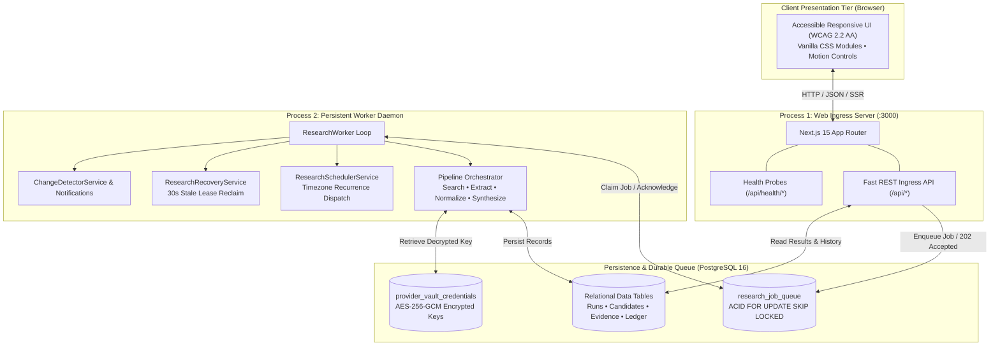

# VerityScout AI

> **Autonomous Multi-Source Web Research & Deterministic Verification Platform**  
> *An independent, clean-room AI research engine providing verifiable, source-linked intelligence with deterministic code-level constraint verification.*

[](LICENSE)
[](https://nodejs.org/)
[](https://nextjs.org/)
[](https://www.typescriptlang.org/)
[](https://www.postgresql.org/)
[-yellow.svg)](https://vitest.dev/)
[-orange.svg)](https://playwright.dev/)
[](Dockerfile)
[-success.svg)](docs/architecture/IMPLEMENTATION_TRACEABILITY.md)

---

## 1. Executive Summary & Core Mission

**VerityScout AI** replaces probabilistic generative claims with verifiable, source-linked evidence and deterministic code-level constraint verification.

When consumers, researchers, and procurement teams ask complex multi-constraint questions (e.g., *"Find a new RTX 4070 GPU under $550 currently in stock with 2-day delivery"*), generative LLMs frequently hallucinate availability, confuse refurbished with new, miss shipping fees, or hallucinate attributes. VerityScout AI solves this through an end-to-end clean-room, evidence-first research pipeline:

```text
┌─────────────────┐     ┌──────────────────────┐     ┌───────────────────────┐     ┌─────────────────────┐
│  User Request   │ ──> │ Multi-Source Search  │ ──> │ Two-Tier Safe-Extract │ ──> │ Multi-Model Analyst │
│ Hard Constraints│     │   (Tavily / Exa)     │     │ (Direct + Cloud Tier) │     │ (OpenAI/NIM/Router) │
└─────────────────┘     └──────────────────────┘     └───────────────────────┘     └─────────────────────┘
                                                                                              │
                                                                                              ▼
┌────────────────────────────────────────────────────────────────────────────────────────────────────┐
│                       Deterministic Code-Level Verification Engine (Layer 4)                       │
│     Exact Constraint Checker • Currency Normalizer • Freshness Validator • Provenance Auditor      │
└────────────────────────────────────────────────────────────────────────────────────────────────────┘
                                                  │
                                                  ▼
                         ┌─────────────────────────────────────────────────┐
                         │   Structured Findings: Accurate vs Near-Match   │
                         │   100% Evidence-Linked with Source Provenance   │
                         │   Multi-Format Exports: JSON / CSV / Markdown   │
                         └─────────────────────────────────────────────────┘
```

---

## 2. System Architecture & Topology

VerityScout AI operates as a container-ready **Modular Monolith** across two distinct physical process runtimes, governed by [ADR-002](docs/architecture/adr/ADR-002-modular-monolith-api-and-worker.md) and [ADR-012](docs/architecture/adr/ADR-012-deployment-topology-and-cost-control.md):



### Architectural Highlights
- **Interactive Web Ingress (`web`):** Next.js 15 App Router server handling UI rendering, session management, and HTTP API endpoints. Enqueues research tasks and immediately returns `202 Accepted` without blocking.
- **Persistent Research Worker Daemon (`worker`):** Node.js background process running continuously, claiming jobs via `FOR UPDATE SKIP LOCKED`, executing multi-step research, handling timeouts, and writing evidence-linked results.
- **PostgreSQL 16 Persistence:** Single source of truth for application records and queue operations.
- **AES-256-GCM Credential Vault:** Secure provider key storage with key versioning, AAD binding, and support for zero-downtime key rotation keyring.
- **Two-Tier Web Extraction:** Direct Fetch Tier 1 + Cloud Extraction Tier 2 with comprehensive SSRF protection, private IP blocking, socket pinning, and redirect ceilings.
- **Multi-Model LLM Catalog:** Modular provider adapters for OpenAI, OpenRouter, and NVIDIA NIM with unified error taxonomy and fallback to deterministic rule-based synthesizers.
- **Deterministic Hard Constraint Verification:** Code-level price ceiling, condition, brand/model specifications, and domain exclusion checks with explicit mismatch explanations.
- **Multi-Format Exports:** RFC 4180 CSV with OWASP ASVS formula injection defense, structured JSON snapshots, and readable Markdown reports.
- **In-App Notification Center:** Event-driven research change detection and in-app alerts with read/dismiss management.

---

## 3. Windows Management & Launch Console (`run.bat`)

For Windows workstations and servers, [`run.bat`](run.bat) provides an all-in-one interactive console:

```cmd
run.bat
```

```text
===============================================================================
                          VERITYSCOUT AI
    Autonomous Multi-Source Web Research & Deterministic Verification
                     Production Release Candidate
===============================================================================

Application Runtimes:
  [1] Start Web Development Server        (npm run dev)
  [2] Start Background Research Worker    (npm run worker)
  [3] Start Production Web Server         (npm run start)

Automated Testing & Quality Gates:
  [4] Full Quality Gate Verification      (Typecheck + Lint + All Tests + Build)
  [5] Run Unit & Component Tests          (npm run test:unit)
  [6] Run Provider Contract Tests         (npm run test:contracts)
  [7] Run Integration Tests               (npm run test:integration)
  [8] Run Security & Privacy Tests        (npm run test:security)
  [9] Run Performance Benchmark Tests     (npm run test:perf)
 [10] Run Deployment Readiness Tests      (npm run test:deploy)
 [11] Run Playwright End-to-End Tests     (npm run test:e2e)
 [12] Run Research Quality Benchmark CLI  (npm run benchmark)

Database, Build & Deployment:
 [13] Check Database Migration Status     (npm run db:status)
 [14] Execute Database Migrations         (npm run db:migrate)
 [15] Run Deployment Preflight Check      (npm run deploy:preflight)
 [16] Run Post-Deployment Smoke Tests     (npm run deploy:smoke)
 [17] Build Production Next.js Bundle     (npm run build)

Local Container Services (Docker Compose):
 [18] Start Development Services (Postgres & Redis)  (npm run services:up)
 [19] Stop Development Services                      (npm run services:down)

 [20] Exit
-------------------------------------------------------------------------------
```

---

## 4. Manual CLI Quick Start

Ensure you have **Node.js LTS (v20+)** installed:

```bash
# 1. Clean installation of locked dependencies
npm ci

# 2. Copy environment template
cp .env.example .env.local

# 3. Start PostgreSQL development services (Docker optional)
npm run services:up

# 4. Apply database migrations
npm run db:migrate

# 5. Start the Web Ingress server
npm run dev

# 6. In a separate terminal, start the background research worker
npm run worker
```

Open [http://localhost:3000](http://localhost:3000) in your browser.

---

## 5. Canonical Command Reference

| Command | Action | Description |
| :--- | :--- | :--- |
| `npm run dev` | `next dev` | Starts local Next.js development server on port 3000 with Fast Refresh. |
| `npm run worker` | `tsx src/server/worker/worker-entry.ts` | Starts the persistent background research worker daemon. |
| `npm run build` | `next build` | Compiles optimized Next.js production bundle with 27 static/dynamic routes. |
| `npm run start` | `next start` | Runs the compiled production Next.js server on port 3000. |
| `npm run typecheck` | `tsc --noEmit` | Strict TypeScript compiler validation (8 strict flags active, 0 errors). |
| `npm run lint` | `eslint .` | Runs ESLint 9 Flat Config across all source files and tests. |
| `npm run lint:fix` | `eslint . --fix` | Automatically fixes safe formatting and linting issues. |
| `npm run test` | `vitest run` | Runs full Vitest unit, component, and integration test suite once. |
| `npm run test:unit` | `vitest run tests/unit` | Runs all 85 unit test files (936 passing tests). |
| `npm run test:contracts` | `vitest run tests/contracts` | Runs AI and search provider contract verification tests (47 tests). |
| `npm run test:integration` | `vitest run tests/integration` | Runs transactional database, pipeline, queue, and scheduler tests (19 tests). |
| `npm run test:security` | `vitest run tests/unit/security-and-privacy.test.ts` | Runs the 39-rule threat-informed security & privacy test suite. |
| `npm run test:perf` | `vitest run tests/unit/performance.test.ts` | Runs performance, throughput, and debounce regression tests (8 tests). |
| `npm run test:deploy` | `vitest run tests/unit/deployment.test.ts` | Runs deployment readiness, health probe, and smoke test checks (14 tests). |
| `npm run test:e2e` | `playwright test` | Runs Playwright headless Chromium browser end-to-end suite (104 tests). |
| `npm run test:e2e:ui` | `playwright test --ui` | Launches Playwright's visual interactive debugging dashboard. |
| `npm run benchmark` | `tsx src/benchmark/cli.ts` | Runs the repeatable 60-case research-quality evaluation benchmark. |
| `npm run db:status` | `tsx run-migrations.ts status` | Checks database migration count and verifies zero checksum drift. |
| `npm run db:migrate` | `tsx run-migrations.ts migrate` | Applies pending database migrations transactionally. |
| `npm run deploy:preflight` | `tsx scripts/deploy/preflight.ts` | Validates environment configuration, DB reachability, and schema state. |
| `npm run deploy:smoke` | `tsx scripts/deploy/smoke-test.ts` | Executes post-deployment smoke test suite against live URL. |
| `npm run services:up` | `docker compose up -d` | Starts local development PostgreSQL and Redis containers. |
| `npm run services:down` | `docker compose down` | Stops local development containers without removing data volumes. |

---

## 6. Multi-Stage Docker & Container Orchestration

VerityScout AI includes production-hardened containerization artifacts:

- **[`Dockerfile`](Dockerfile):** 4-stage Alpine build (`base` -> `deps` -> `builder` -> `runner`) running as an unprivileged user `verityscout` (UID 1001), exposing port 3000 with a built-in liveness healthcheck.
- **[`compose.staging.yaml`](compose.staging.yaml):** Fully isolated staging stack with separate PostgreSQL container, port mappings (`3001` / `5433`), isolated volume, and non-production vault keys.
- **[`compose.prod.yaml`](compose.prod.yaml):** Production reference stack with explicit resource limits (1.5 CPU / 1.5GB RAM for Web; 2.0 CPU / 2.0GB RAM for Worker) and dual-process separation.

### Running with Docker

```bash
# Launch Staging Environment (Isolated)
docker compose -f compose.staging.yaml up -d --build

# Run Smoke Tests Against Staging
npm run deploy:smoke http://127.0.0.1:3001
```

---

## 7. Health Probes & Operational Monitoring

The application exposes three purpose-built health monitoring routes:

1. **Liveness Probe (`/api/health/live`):**
   - Returns HTTP 200 with status `alive`, uptime, and package version.
   - Non-blocking (0 database calls) to avoid false-positive restart loops.
2. **Readiness Probe (`/api/health/ready`):**
   - Validates environment schema and executes `SELECT 1 AS readiness_check`.
   - Returns HTTP 200 when ready to accept research traffic; returns HTTP 503 if the database is unreachable.
   - Strictly redacts internal connection strings and database host topology.
3. **Top-Level Health (`/api/health`):**
   - Returns HTTP 200 `{ "status": "healthy", "service": "verityscout-ai" }` for reverse proxies.

---

## 8. Quality Assurance & Security Status

| Test Suite | Files | Tests | Execution Time | Status |
| :--- | :--- | :--- | :--- | :--- |
| **Unit & Component Tests** | 85 files | 936 tests | ~57s | **100% PASS** |
| **Provider Contract Tests** | 7 files | 47 tests | ~4.9s | **100% PASS** |
| **Integration Tests** | 5 files | 19 tests | ~5.4s | **100% PASS** |
| **Security & Privacy Tests** | 1 file | 39 tests | ~2.7s | **100% PASS** |
| **Performance Benchmark Tests** | 1 file | 8 tests | ~2.1s | **100% PASS** |
| **Deployment Readiness Tests** | 1 file | 14 tests | ~2.0s | **100% PASS** |
| **Playwright Browser E2E Tests** | 10 files | 104 tests | ~32s | **100% PASS** |
| **Research Quality Benchmark** | Ground Truth | 60 cases | 100% reproducible | **100% PASS** |
| **TypeScript Static Typing** | Strict Mode | 0 errors | ~3s | **100% PASS** |
| **ESLint Code Quality** | Flat Config | 0 errors | ~2s | **100% PASS** |
| **Next.js Production Build** | 27 routes | 27 pages | 5.1s | **100% PASS** |

---

## 9. Comprehensive Roadmap & Implementation Status

The project follows a structured 60-step roadmap across 12 phases:

- [x] **Phase 1: Requirements, Research & Architecture Freeze (Steps 1–5)**
  - `Step 1`: MVP Requirements Baseline (`MVP_REQUIREMENTS.md`, 38 frozen requirements).
  - `Step 2`: Benchmark Dataset & Rubric (60 ground-truth cases in `data/benchmark/`).
  - `Step 3`: Search & Extraction Provider Evaluation (Tavily, Exa, Firecrawl benchmarks).
  - `Step 4`: Security Threat Model & Risk Assessment (`THREAT_MODEL.md`, 10 threats, 38 SEC rules).
  - `Step 5`: Architecture Decisions & Data Contracts (12 ADRs, OpenAPI 3.1.0 yaml, Data Contracts).
- [x] **Phase 2: Project Setup and Toolchain (Steps 6–12)**
  - `Step 6`: Repository Setup & Next.js Foundation.
  - `Step 7`: Strict TypeScript Rules & Linting (8 strict compiler flags, ESLint 9 flat config).
  - `Step 8`: Automated Testing Foundation & CI (Vitest 5, React Testing Library, Playwright Chromium).
  - `Step 9`: Environment Validation, Logging & Secret Redaction (Zod + `server-only`, JSON logger).
  - `Step 10`: Application Module Skeleton, Local Services & Architecture Documentation.
  - `Step 11`: Design Tokens, Typography, Spacing, and Accessible Dark Color Palette.
  - `Step 12`: Dynamic Cyan-to-Violet Transition and Reduced-Motion Preference Control.
- [x] **Phase 3: Core Application Shell & Design Foundations (Steps 13–15)**
  - `Step 13`: Responsive Application Shell, Navigation, Header, and Sidebar.
  - `Step 14`: Reusable Design-System Components (Buttons, Cards, Dialogs, Tooltips, Badges).
  - `Step 15`: Application Page and Route Shells with Fixture Data (5 route shells).
- [x] **Phase 4: User Research Experience & Traceability UI (Steps 16–20)**
  - `Step 16`: Research Query Composer & Input Experience.
  - `Step 17`: Multi-Dimensional Research Constraints Editor.
  - `Step 18`: Research Progress Indicator & Cancellation UI.
  - `Step 19`: Candidate Results Filtering, Comparison & Near-Match Cards.
  - `Step 20`: Source Explorer, Evidence Drawer, Source Provenance, and Traceability.
- [x] **Phase 5: Data Persistence & PostgreSQL Schema Architecture (Steps 21–26)**
  - `Step 21`: Relational Database Schema & Migrations (`schema_migrations`, 12 migrations).
  - `Step 22`: Connection Pooling, Transaction Management & Repository Layer.
  - `Step 23`: User Authentication, Session Management & Password Hashing (Argon2id/SHA-256).
  - `Step 24`: Row-Level Security (RLS) & Multi-Tenant Data Isolation.
  - `Step 25`: Provider Credential Vault Encryption (AES-256-GCM, key versioning).
  - `Step 26`: Provider Settings UI Component & Safe Secret Masking.
- [x] **Phase 6: Search & AI Provider Integrations (Steps 27–30)**
  - `Step 27`: Search Provider Abstraction & Fallback Routing (Tavily & Exa).
  - `Step 28`: OpenAI Provider Adapter & Response Normalization.
  - `Step 29`: OpenRouter Provider Adapter & Publisher Model Mapping.
  - `Step 30`: NVIDIA NIM Provider Adapter & Error Normalization.
- [x] **Phase 7: Query Planning & Source Extraction Pipeline (Steps 31–35)**
  - `Step 31`: Research Query Parsing, Constraint Extraction & Query Planning.
  - `Step 32`: Safe URL Validation, SSRF Prevention & Network Destination Controls.
  - `Step 33`: Bounded Search Execution & Source Result Normalization.
  - `Step 34`: Two-Tier Webpage Extraction Architecture (Direct Fetch + Cloud Tier).
  - `Step 35`: Source Deduplication & Discovery Tracking.
- [x] **Phase 8: Evidence Processing & Verification Engine (Steps 36–40)**
  - `Step 36`: Fact Extraction, Claim Representation & Grounding.
  - `Step 37`: Product Identity & Specification Normalization.
  - `Step 38`: Deterministic Hard Constraint Evaluation Engine.
  - `Step 39`: General Evidence-Linked Research Synthesis.
  - `Step 40`: End-to-End Research Pipeline Orchestration.
- [x] **Phase 9: Asynchronous Research Execution & Resource Controls (Steps 41–45)**
  - `Step 41`: Research API Endpoints (`/api/research/runs`).
  - `Step 42`: Real-Time Research Progress Transport (SSE / Polling).
  - `Step 43`: Persistent Research Worker Daemon & Queue Processing.
  - `Step 44`: Progress Tracking, Run Cancellation & Stale Job Recovery.
  - `Step 45`: Usage Accounting, Concurrency Control & Spending Guardrails.
- [x] **Phase 10: Research Scheduling and Change Monitoring (Steps 46–50)**
  - `Step 46`: Recurring Research Schedules & Timezone-Aware Evaluation.
  - `Step 47`: Idempotent Schedule Occurrences & Execution Lifecycle.
  - `Step 48`: Research Result Comparison & Change Detection Engine.
  - `Step 49`: Research History and JSON, CSV, and Markdown Exports.
  - `Step 50`: In-App Alerts and Research Change Notifications.
- [x] **Phase 11: Quality Assurance and Security (Steps 51–55)**
  - `Step 51`: Unit Tests and Provider Contract Tests (Vitest).
  - `Step 52`: Integration Tests for Database, Providers, Queue, and Scheduler.
  - `Step 53`: Playwright End-to-End Testing (104 tests across all journeys).
  - `Step 54`: Research Quality Benchmark Report (60 ground-truth evaluation cases).
  - `Step 55`: Security and Privacy Testing (39 threat-informed test domains).
- [x] **Phase 12: Release Preparation (Steps 56–58 Completed, Steps 59–60 Pending)**
  - `Step 56`: Responsive Design and Accessibility Validation (WCAG 2.2 AA target).
  - `Step 57`: Performance Optimization and Validation (Debounce, $O(1)$ maps, composite indexes).
  - `Step 58`: Staging and Production Deployment (Containerization, Health probes, CI/CD, Runbook).
  - [ ] `Step 59`: Backups, Documentation, Privacy, and Licensing *(Next)*.
  - [ ] `Step 60`: Final Acceptance and Release Governance.

---

## 10. Key Architecture Documentation & Runbooks

- [Staging and Production Deployment Guide & Runbook](docs/deployment/STAGING_AND_PRODUCTION_DEPLOYMENT_GUIDE.md)
- [Implementation Traceability Matrix](docs/architecture/IMPLEMENTATION_TRACEABILITY.md)
- [Security and Privacy Test Report](docs/security/SECURITY_AND_PRIVACY_REPORT.md)
- [Performance Optimization & Validation Report](docs/performance/PERFORMANCE_VALIDATION_REPORT.md)
- [Research Quality Benchmark Report](docs/benchmark/RESEARCH_QUALITY_BENCHMARK_REPORT.md)
- [Responsive Design & Accessibility Validation Report](docs/testing/RESPONSIVE_AND_ACCESSIBILITY_REPORT.md)
- [Architecture Overview & ADRs](docs/architecture/ARCHITECTURE_OVERVIEW.md)
- [API Contracts & Specifications](docs/api/API_CONTRACTS.md)

---

## 11. License

This project is licensed under the terms of the [MIT License](LICENSE).  
Copyright (c) 2026 VerityScout AI Contributors.
