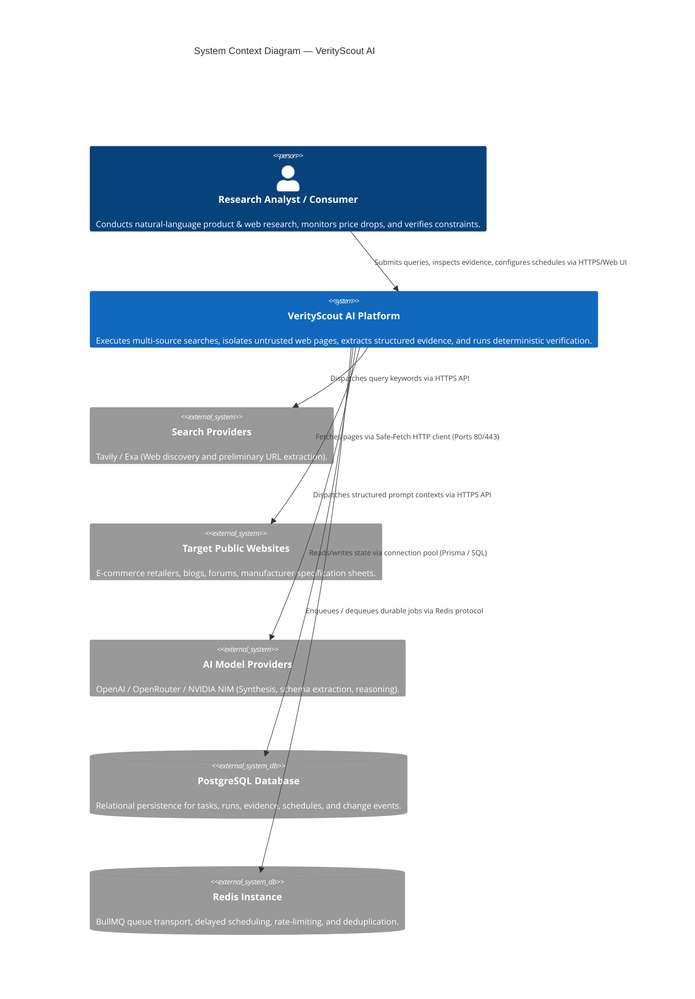
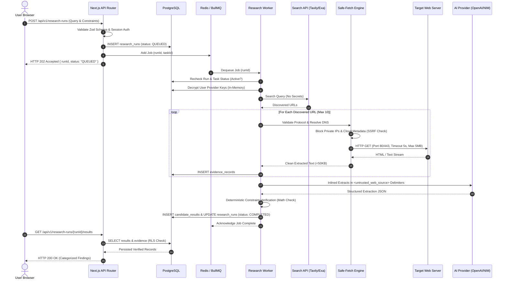
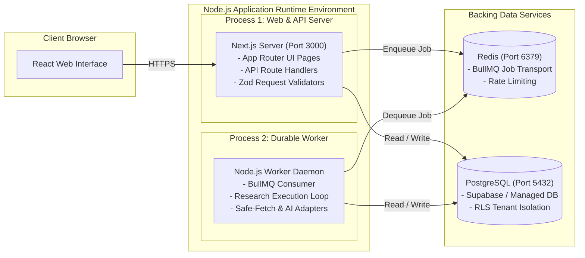

# VerityScout AI — System Architecture Overview

**Document Identifier:** VS-ARCH-OVERVIEW-v1.0  
**Status:** ACTIVE ARCHITECTURAL BASELINE / PHASE 2 IN PROGRESS (Step 10 of 60)  
**Phase:** Phase 2 (Project Setup and Toolchain) — Step 10 of 60  
**Author:** Principal Software Architect & Engineering Team  
**Traceability:** Mapped to [MVP_REQUIREMENTS.md](file:///e:/Projects/All%20working%20projects/Website%20Working%20Projects/VerityScout%20AI%20WEB%20(working)/docs/requirements/MVP_REQUIREMENTS.md), [THREAT_MODEL.md](file:///e:/Projects/All%20working%20projects/Website%20Working%20Projects/VerityScout%20AI%20WEB%20(working)/docs/security/THREAT_MODEL.md), and [DECISION_REGISTER.md](file:///e:/Projects/All%20working%20projects/Website%20Working%20Projects/VerityScout%20AI%20WEB%20(working)/docs/requirements/DECISION_REGISTER.md).

---

## 1. Executive Summary & Architectural Mission

VerityScout AI is an autonomous, multi-source web research and deterministic verification platform. Unlike conventional AI search aggregators that rely on probabilistic language model summaries, VerityScout AI enforces a strict **"evidence-first"** architecture: every claim, specification, price quote, and availability state must be backed by a verifiable source URL, exact text excerpt, and timestamped extraction record.

The system is designed as a **TypeScript-based modular monolith** with a decoupled, durable background worker. This topology guarantees high developer velocity, shared type safety across boundaries, and resilient long-running asynchronous execution without the operational overhead of microservices or Kubernetes.

---

## 2. System Context & External Interfaces

The following System Context diagram illustrates VerityScout AI's boundaries, user personas, and external system integrations:

---

## 3. Logical Component Architecture

VerityScout AI is partitioned into eight strictly decoupled logical layers. Direct circular dependencies and cross-layer bypassing are prohibited.

```mermaid
flowchart TD
    subgraph L1 ["Presentation Layer (Next.js App Router / React)"]
        UI_Query["Query Composer & Constraints"]
        UI_Progress["Progress & Status Visualizer"]
        UI_Results["Result Explorer & Tier Filter"]
        UI_Evidence["Evidence & Provenance Inspector"]
        UI_Schedule["Schedule & History Manager"]
        UI_Settings["Provider Settings & BYOK Vault"]
    end

    subgraph L2 ["API & Ingress Layer (Next.js Route Handlers)"]
        Middleware["Auth, CSRF & Rate-Limit Middleware"]
        Router_Tasks["/api/v1/research-tasks"]
        Router_Runs["/api/v1/research-runs"]
        Router_Schedules["/api/v1/schedules"]
        Router_Settings["/api/v1/settings/providers"]
        Router_Health["/api/v1/health & /capabilities"]
    end

    subgraph L3 ["Domain & Business Logic Services"]
        Svc_Planner["Research Planner"]
        Svc_Constraint["Constraint Normalizer"]
        Svc_Verifier["Deterministic Constraint Verifier"]
        Svc_Ranker["Result Categorizer & Ranker"]
        Svc_Change["Change Detection Engine"]
        Svc_Cost["Usage & Cost Ledger Service"]
        Svc_Router["Privacy-Aware Model Router"]
    end

    subgraph L4 ["Evidence & Verification Engine"]
        Canon_URL["URL Canonicalizer & Deduplicator"]
        Fact_Extract["Structured Fact Extractor"]
        Conflict_Resolver["Conflict & Provenance Tracker"]
        Freshness_Eval["Freshness Evaluator"]
    end

    subgraph L5 ["Provider Adapter Layer"]
        Adapter_Search["ISearchProvider (Tavily / Exa)"]
        Adapter_Extract["IExtractionProvider (SafeFetch / Firecrawl)"]
        Adapter_LLM["ILLMProvider (OpenAI / OpenRouter / NIM)"]
        Adapter_Catalog["IModelCatalog (Capability Matrix)"]
    end

    subgraph L6 ["Worker & Queue Execution Layer"]
        Queue_Producer["BullMQ Job Dispatcher"]
        Worker_Process["Persistent Research Worker"]
        Job_Scheduler["Repeatable Job Coordinator"]
        DLQ_Handler["Dead-Letter Queue & Backoff Monitor"]
    end

    subgraph L7 ["Persistence & Data Access Layer"]
        Repo_Tasks["Task & Run Repository"]
        Repo_Evidence["Source & Evidence Repository"]
        Repo_Results["Candidate Result Repository"]
        Repo_Schedules["Schedule & Change Repository"]
        Repo_Vault["Encrypted Credential Repository"]
    end

    subgraph L8 ["Security & Infrastructure Support Layer"]
        Sec_SafeFetch["Safe-Fetch DNS Pre-Resolver & SSRF Blocklist"]
        Sec_DOMPurify["DOMPurify HTML/Markdown Sanitizer"]
        Sec_Redactor["Structured Logging Redaction Engine"]
        Sec_Crypto["AES-256-GCM Vault Service"]
    end

    L1 -->|"JSON / HTTPS / Session Cookie"| L2
    L2 --> L3
    L2 --> L7
    L2 -->|"Enqueue Job UUID"| L6
    L6 --> L3
    L3 --> L4
    L3 --> L5
    L4 --> L7
    L6 --> L7
    L5 --> L8
    L6 --> L8
    L7 --> L8
```

---

## 4. Module Responsibilities & Dependency Rules

### 4.1 Layer Breakdown & Responsibilities
1. **Presentation Layer (`src/components/`, `src/app/`):**
   - Renders query inputs, tier-based finding cards, evidence snippets, and schedule dashboards.
   - Strictly consumes normalized API responses; never holds server secrets (`NEXT_PUBLIC_` secret ban).
   - Zero direct database or Redis connections.

2. **API Layer (`src/app/api/v1/`):**
   - Validates all request payloads using Zod schemas (`.strict()`).
   - Resolves authenticated session user ID and enforces Object-Level Ownership (`WHERE id = :id AND user_id = :userId`).
   - Dispatches long-running jobs to BullMQ asynchronously; returns HTTP 202 Accepted with status URLs immediately.

3. **Domain Layer (`src/domain/`):**
   - Pure business logic independent of external SDKs and database clients.
   - Evaluates numeric constraints (price ceilings, dimensions) via TypeScript arithmetic, completely ignoring natural-language assertions.

4. **Evidence & Verification Layer (`src/evidence/`):**
   - Normalizes discovered URLs, tracks content hashes, calculates extraction timestamps, and detects conflicts between divergent retailer claims.

5. **Provider Adapter Layer (`src/providers/`):**
   - Implements normalized interfaces (`ISearchProvider`, `IExtractionProvider`, `ILLMProvider`).
   - Encapsulates provider-specific SDK idiosyncrasies and converts external errors into standard application error models.

6. **Worker & Queue Layer (`src/worker/`):**
   - Executes research pipelines outside of web HTTP timeouts.
   - Performs atomic pre-checks on task status before incurring provider expenses; enforces idempotency and bounded retries.

7. **Persistence Layer (`src/persistence/`):**
   - Type-safe database queries via PostgreSQL ORM/Query Builder.
   - Enforces relational foreign-key cascades and transactional atomicity.

8. **Security & Operations Layer (`src/security/`):**
   - Pre-fetch DNS IP resolution, SSRF blocking, AES-256-GCM credential encryption, and logging redaction.

### 4.2 Architectural Dependency Governance Rules
- **Rule 1 (Downward Flow Only):** Presentation $\rightarrow$ API $\rightarrow$ Domain $\rightarrow$ Persistence. Higher layers may import lower layers; lower layers must never import higher layers.
- **Rule 2 (Domain Isolation):** The Domain Layer must not import Next.js route handlers, React components, or third-party provider SDKs.
- **Rule 3 (Zero Direct Infrastructure in UI):** The UI layer communicates strictly with `/api/v1/*` endpoints; it must never connect to PostgreSQL, Redis, or external AI APIs directly.
- **Rule 4 (No Plaintext Secrets in Queue):** Queue payloads may only carry UUIDs (`taskId`, `runId`, `userId`); credentials must be loaded just-in-time from the encrypted vault.

---

## 5. Primary Data Flows & Lifecycle Sequences

### 5.1 Interactive Research Run Execution

---

## 6. Trust Boundaries & Security Architecture Alignment

Reconciled with the 6 trust boundaries defined in [THREAT_MODEL.md](file:///e:/Projects/All%20working%20projects/Website%20Working%20Projects/VerityScout%20AI%20WEB%20(working)/docs/security/THREAT_MODEL.md):

| Trust Boundary | Boundary Scope | Primary Threats Addressed | Architectural Enforcement Control |
|---|---|---|---|
| **TB-1** | Browser UI $\leftrightarrow$ Application API | XSS, CSRF, BOLA / IDOR, Session Hijacking | `HttpOnly` `Secure` `SameSite=Lax` cookies (SEC-006), Server-side ownership checks (SEC-007), DOMPurify sanitization (SEC-021), strict CSP (SEC-022). |
| **TB-2** | Application API $\leftrightarrow$ BullMQ / Redis | Unauthorized job creation, Redis injection, Retry storms | Redis ACL authentication, No secrets in queue payloads (SEC-005), Max 3 retries with Dead-Letter Queue (SEC-028). |
| **TB-3** | Research Worker $\leftrightarrow$ Public Internet | SSRF to private subnets & cloud metadata, Decompression bombs | Pre-fetch DNS resolution & IP blocklisting (SEC-012), 3-hop redirect inspection (SEC-013), 5MB response cap (SEC-014), Port 80/443 restriction (SEC-015). |
| **TB-4** | Research Worker $\leftrightarrow$ AI / Search APIs | Prompt injection, Secret theft, Unauthorized fallback | XML delimiter framing (SEC-016), Deterministic code verification (SEC-017), Strict provider fallback whitelisting (SEC-031), Zero secrets in prompts (SEC-020). |
| **TB-5** | Server Runtime $\leftrightarrow$ Persistence Store | Cross-tenant data leakage, SQL injection | Parameterized queries (SEC-023), PostgreSQL Row Level Security (SEC-008), Cascading task deletion (SEC-033). |
| **TB-6** | Application Logging $\leftrightarrow$ Observability | Token disclosure in server logs and traces | Centralized regex-based secret redaction filter for all logger transports (SEC-003). |

---

## 7. Deployment Topology & Physical Process Model

VerityScout AI is deployed as two synchronized Node.js processes sharing access to backing data services:

- **Process 1 (Web & API Server):** Handles inbound HTTP web requests, renders Server Components, executes lightweight route handlers, and returns fast responses (<200ms).
- **Process 2 (Research Worker Daemon):** Independent long-running Node.js process dedicated to executing research pipelines, managing socket timeouts, and isolating CPU-heavy DOM parsing from the web server.

---

## 8. Explicit Architecture Decisions & Unresolved Choices

### Confirmed Architectural Decisions (Approved Baseline)
1. **Full-Stack TypeScript:** Unified type system across frontend, API, domain, and worker (`ADR-001`).
2. **Modular Monolith with Persistent Worker:** Clean separation between interactive HTTP handlers and durable background research execution (`ADR-002`).
3. **Relational Database (PostgreSQL):** Authoritative persistence for structured evidence and tenant isolation (`ADR-003`).
4. **BullMQ over Redis:** Durable queue transport supporting repeatable scheduling and backoff retries (`ADR-004`).
5. **Deterministic Constraint Verification:** Numeric comparisons executed by code, never probabilistic LLM claims (`ADR-007`).

### Decisions Pending Explicit User / Budget Authorization
1. **Live Search Provider Final Adoption (`OPEN-002`):** Pluggable architecture ready; final production selection between Tavily, Exa, and Firecrawl requires live benchmark execution (`REC-001`, $2.00 test budget cap).
2. **Target Hosting Infrastructure (`OPEN-006`):** Choice between Vercel + Railway/Render vs. self-hosted VPS to be finalized in Step 58.
3. **Legal Jurisdiction & Privacy Baseline (`OPEN-011`):** US vs. EU/Global regulatory compliance strategy requires formal review prior to commercial launch.
