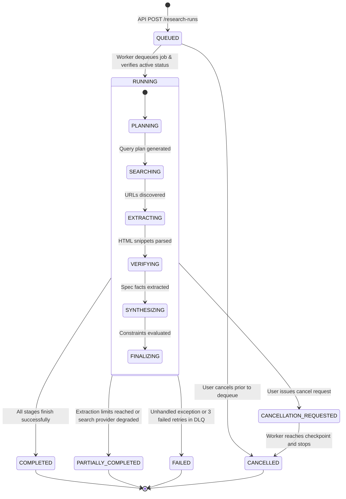
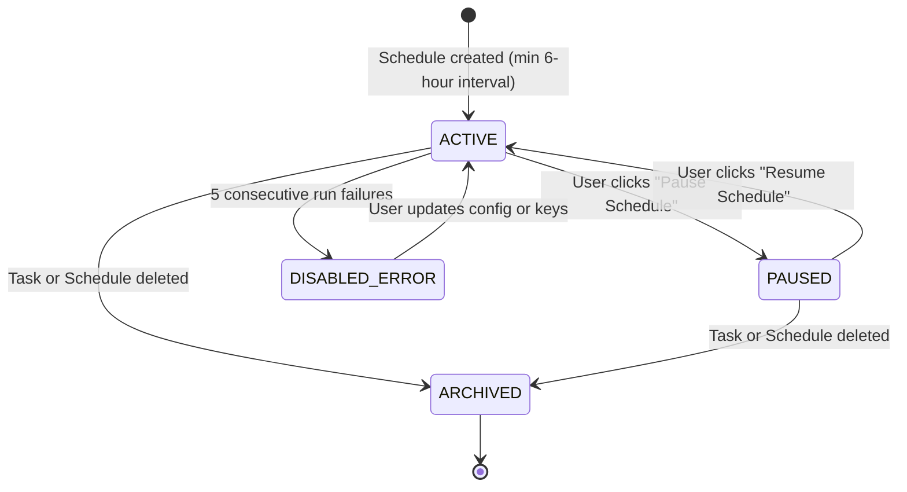

# VerityScout AI — Canonical Domain Data Contracts & State Specifications

**Document Identifier:** VS-DATA-CONTRACT-v1.0  
**Status:** APPROVED ARCHITECTURAL SPECIFICATION  
**Phase:** Phase 1 (Step 5 of 60)  
**Author:** Principal Software Architect, Database Architect  
**Traceability:** Mapped to [MVP_REQUIREMENTS.md](file:///e:/Projects/All%20working%20projects/Website%20Working%20Projects/VerityScout%20AI%20WEB%20(working)/docs/requirements/MVP_REQUIREMENTS.md), [THREAT_MODEL.md](file:///e:/Projects/All%20working%20projects/Website%20Working%20Projects/VerityScout%20AI%20WEB%20(working)/docs/security/THREAT_MODEL.md), and [SECURITY_REQUIREMENTS.md](file:///e:/Projects/All%20working%20projects/Website%20Working%20Projects/VerityScout%20AI%20WEB%20(working)/docs/security/SECURITY_REQUIREMENTS.md).

---

## 1. Purpose & Shared Contract Conventions

This document establishes the official canonical data contracts, entity schemas, versioned enumerations, and state transition machines for VerityScout AI. These contracts govern all internal domain models, database tables, queue payloads, and API data transfer objects (DTOs).

### 1.1 Universal Representation Conventions
1. **Identifiers:** All entity IDs are RFC 4122 **UUIDv4** strings (e.g., `550e8400-e29b-41d4-a716-446655440000`).
2. **Timestamps:** All timestamps are serialized as **UTC ISO 8601 strings** with millisecond precision (`YYYY-MM-DDTHH:mm:ss.sssZ`). Scheduled recurrence configurations store the user's local IANA timezone string separately (e.g., `America/New_York`).
3. **Monetary Values & Budgets:** Stored as exact numeric strings (e.g., `"549.99"`) or integer cents (e.g., `54999`) with a 3-letter ISO 4217 currency code (default: `"USD"`). **Binary floating-point arithmetic (`number` in JS) is strictly prohibited for monetary evaluations.**
4. **Physical Dimensions:** Stored in normalized metric units (e.g., millimeters for length, grams for weight) as integer or fixed-point numbers.
5. **Nullability vs. Optionality:**
   - `null`: Field was actively evaluated and confirmed to be absent or not applicable in the source.
   - `undefined` (omitted): Field is optional in the DTO or was not queried.

---

## 2. Canonical Enumerations & Classification Tiers

### 2.1 Task & Run States
```typescript
export enum TaskType {
  PRODUCT_RESEARCH = 'PRODUCT_RESEARCH',
  GENERAL_RESEARCH = 'GENERAL_RESEARCH',
  PRICE_MONITOR = 'PRICE_MONITOR',
  SPEC_VERIFICATION = 'SPEC_VERIFICATION'
}

export enum RunStatus {
  QUEUED = 'QUEUED',
  RUNNING = 'RUNNING',
  COMPLETED = 'COMPLETED',
  PARTIALLY_COMPLETED = 'PARTIALLY_COMPLETED',
  FAILED = 'FAILED',
  CANCELLATION_REQUESTED = 'CANCELLATION_REQUESTED',
  CANCELLED = 'CANCELLED'
}

export enum RunStage {
  INITIATED = 'INITIATED',
  PLANNING = 'PLANNING',
  SEARCHING = 'SEARCHING',
  EXTRACTING = 'EXTRACTING',
  VERIFYING = 'VERIFYING',
  SYNTHESIZING = 'SYNTHESIZING',
  FINALIZING = 'FINALIZING'
}
```

### 2.2 Source & Evidence States
```typescript
export enum SourceAccessState {
  ACCESSIBLE = 'ACCESSIBLE',
  BLOCKED_BOT_CHALLENGE = 'BLOCKED_BOT_CHALLENGE',
  HTTP_ERROR = 'HTTP_ERROR',
  TIMEOUT = 'TIMEOUT',
  DNS_RESOLUTION_FAILED = 'DNS_RESOLUTION_FAILED',
  SSRF_PROHIBITED = 'SSRF_PROHIBITED'
}

export enum ExtractionState {
  SUCCESS = 'SUCCESS',
  EMPTY_BODY = 'EMPTY_BODY',
  PAYLOAD_TOO_LARGE = 'PAYLOAD_TOO_LARGE',
  PARSING_FAILED = 'PARSING_FAILED',
  SKIPPED = 'SKIPPED'
}

export enum VerificationState {
  SUPPORTED = 'SUPPORTED',          // Backed by explicit textual evidence
  CONTRADICTED = 'CONTRADICTED',    // Factual evidence refutes the claim
  UNKNOWN = 'UNKNOWN',              // Not mentioned or found in extracted text
  CONFLICTING = 'CONFLICTING',      // Multiple reputable sources disagree
  STALE = 'STALE'                   // Evidence timestamp is older than threshold (>24h)
}
```

### 2.3 Result Match Classifications
```typescript
export enum MatchClassification {
  EXACT_MATCH = 'EXACT_MATCH',            // 100% of hard constraints satisfied
  NEAR_MATCH = 'NEAR_MATCH',              // Meets core constraints; minor flexible deviation
  PARTIALLY_VERIFIED = 'PARTIALLY_VERIFIED', // Some specs verified, others unknown
  CONFLICTING = 'CONFLICTING',            // Sources offer incompatible specs/prices
  EXCLUDED = 'EXCLUDED'                   // Definitively violates a hard constraint
}

export enum ScheduleStatus {
  ACTIVE = 'ACTIVE',
  PAUSED = 'PAUSED',
  DISABLED_ERROR = 'DISABLED_ERROR',
  ARCHIVED = 'ARCHIVED'
}

export enum ChangeType {
  PRICE_DROP = 'PRICE_DROP',
  PRICE_INCREASE = 'PRICE_INCREASE',
  STOCK_STATUS_CHANGE = 'STOCK_STATUS_CHANGE',
  SPECIFICATION_UPDATE = 'SPECIFICATION_UPDATE',
  NEW_OFFER_DISCOVERED = 'NEW_OFFER_DISCOVERED'
}
```

---

## 3. Core Domain Entity Contracts

### 3.1 ResearchTask
Represents a user's persistent research definition and parameter constraints.

```typescript
export interface ResearchTask {
  id: string;                         // UUIDv4 primary key
  userId: string;                     // Owner UUIDv4 foreign key
  title: string;                      // User-facing task title (max 200 chars)
  originalQuery: string;              // Natural language query (max 500 chars)
  taskType: TaskType;                 // Task classification enum
  
  // Normalized Constraints
  constraints: {
    maxPrice?: string;                // Exact decimal string (e.g. "550.00")
    minPrice?: string;                // Exact decimal string
    currency: string;                 // ISO 4217 currency code (default: "USD")
    requiredCondition?: 'NEW' | 'REFURBISHED' | 'USED' | 'ANY';
    requiredBrand?: string;
    excludedKeywords: string[];       // Must not contain keywords
    requiredSpecs: Record<string, string | number>; // e.g. { "maxGpuLengthMm": 320 }
  };

  // Operational Guardrails
  limits: {
    maxSources: number;               // Max URLs to extract per run (default: 10, max: 20)
    maxSearchQueries: number;         // Max search queries (default: 5)
    maxRunCostUsd: string;            // Hard spending cap per run (default: "0.25")
    searchDepth: 'QUICK' | 'BALANCED' | 'DEEP';
  };

  // Model & Privacy Directives
  modelPolicy: {
    preferredProvider: 'openai' | 'openrouter' | 'nim' | 'auto';
    pinnedModelId?: string;           // Optional explicit model
    allowedProviders: string[];       // Privacy fallback whitelist (SEC-031)
  };

  isArchived: boolean;
  createdAt: string;                  // ISO 8601 UTC
  updatedAt: string;                  // ISO 8601 UTC
}
```

### 3.2 ResearchRun
Represents an individual execution of a research task.

```typescript
export interface ResearchRun {
  id: string;                         // UUIDv4 primary key
  taskId: string;                     // Foreign key -> ResearchTask.id (ON DELETE CASCADE)
  scheduleId?: string;                // Optional foreign key -> ResearchSchedule.id
  idempotencyKey: string;             // SHA256(taskId + timestamp) (SEC-027)
  status: RunStatus;                  // Execution state
  currentStage: RunStage;             // Progress stage
  
  // Execution Telemetry
  stageCounters: {
    queriesExecuted: number;
    sourcesDiscovered: number;
    sourcesExtracted: number;
    claimsVerified: number;
  };

  // Cost & Usage
  usage: {
    promptTokens: number;
    completionTokens: number;
    searchCredits: number;
    estimatedCostUsd: string;         // Decimal string (e.g. "0.0412")
  };

  selectedProvider: string;           // Provider that executed synthesis
  selectedModel: string;              // Model that executed synthesis
  errorMessage?: string;              // Sanitized error message on failure
  cancellationReason?: string;

  startedAt: string;                  // ISO 8601 UTC
  completedAt?: string;               // ISO 8601 UTC (if finished)
}
```

### 3.3 SourceDocument
Represents a web page discovered and processed during research.

```typescript
export interface SourceDocument {
  id: string;                         // UUIDv4 primary key
  runId: string;                      // Foreign key -> ResearchRun.id (ON DELETE CASCADE)
  originalUrl: string;                // Discovered URL
  canonicalUrl: string;               // Normalized, tracking-parameter-stripped URL
  domain: string;                     // Extracted hostname (e.g. "retailer.com")
  title: string;                      // Web page title (sanitized)
  discoveryProvider: string;          // "tavily" | "exa" | "direct"
  
  accessState: SourceAccessState;
  extractionState: ExtractionState;
  httpStatusCode?: number;
  contentHash?: string;               // SHA256 of extracted raw text
  extractedTextExcerpt: string;       // Bounded text snippet (<50KB, SEC-032)
  retrievedAt: string;                // ISO 8601 UTC
}
```

### 3.4 EvidenceRecord
Represents a verified or refuted factual claim grounded in source text.

```typescript
export interface EvidenceRecord {
  id: string;                         // UUIDv4 primary key
  runId: string;                      // Foreign key -> ResearchRun.id (ON DELETE CASCADE)
  sourceId: string;                   // Foreign key -> SourceDocument.id (ON DELETE CASCADE)
  candidateId?: string;               // Optional link to CandidateResult.id
  
  claimKey: string;                   // e.g. "price", "gpu_length_mm", "stock_status"
  extractedRawValue: string;          // Literal string from page (e.g. "$549.99")
  normalizedValue: string | number;   // Typed value (e.g. 549.99)
  unitOrCurrency?: string;            // "USD", "mm", "GB"
  
  verbatimQuote: string;              // Direct textual excerpt from source
  verificationState: VerificationState;
  conflictDetails?: string;           // Explanation if conflicting with another source
  extractionMethod: 'LLM_STRUCTURED' | 'REGEX_DETERMINISTIC' | 'META_TAG';
  extractedAt: string;                // ISO 8601 UTC
}
```

### 3.5 CandidateResult
Represents a structured product or research finding evaluated against user constraints.

```typescript
export interface CandidateResult {
  id: string;                         // UUIDv4 primary key
  runId: string;                      // Foreign key -> ResearchRun.id (ON DELETE CASCADE)
  title: string;                      // Product or article title
  productIdentifier?: string;         // Model number, SKU, or UPC (if available)
  sellerOrDomain: string;             // Retailer or publisher name
  canonicalUrl: string;               // Direct product URL
  
  // Verified Attributes
  priceUsd?: string;                  // Evaluated price decimal string
  availability: 'IN_STOCK' | 'OUT_OF_STOCK' | 'UNKNOWN';
  condition: 'NEW' | 'REFURBISHED' | 'USED' | 'UNKNOWN';
  specifications: Record<string, string | number>; // Normalized spec table
  
  // Constraint Evaluation Matrix
  classification: MatchClassification;
  constraintEvaluation: {
    passedConstraints: string[];      // List of constraint keys that satisfied rules
    failedConstraints: string[];      // List of constraint keys that violated rules
    mismatchReason?: string;          // Human-readable explanation of failure
  };

  evidenceIds: string[];              // References to supporting EvidenceRecord.id
  createdAt: string;                  // ISO 8601 UTC
}
```

### 3.6 ResearchSchedule
Defines recurrence parameters for automated periodic monitoring.

```typescript
export interface ResearchSchedule {
  id: string;                         // UUIDv4 primary key
  taskId: string;                     // Foreign key -> ResearchTask.id (ON DELETE CASCADE)
  userId: string;                     // Owner UUIDv4
  status: ScheduleStatus;             // ACTIVE | PAUSED | DISABLED_ERROR
  
  cronExpression: string;             // Standard 5-field cron (min 6-hour interval, SEC-036)
  timezone: string;                   // IANA timezone string (e.g. "America/New_York")
  
  lastRunAt?: string;                 // ISO 8601 UTC
  nextRunAt: string;                  // ISO 8601 UTC
  consecutiveFailures: number;        // Tripping circuit breaker at 5 failures
  
  changeNotificationThresholdPct: number; // e.g. 2.0 (triggers alert if price drops >= 2%)
  createdAt: string;
  updatedAt: string;
}
```

### 3.7 ChangeEvent
Records an audited difference between two consecutive execution runs.

```typescript
export interface ChangeEvent {
  id: string;                         // UUIDv4 primary key
  taskId: string;                     // Foreign key -> ResearchTask.id
  scheduleId: string;                 // Foreign key -> ResearchSchedule.id
  previousRunId: string;              // Foreign key -> ResearchRun.id
  currentRunId: string;               // Foreign key -> ResearchRun.id
  
  changeType: ChangeType;             // PRICE_DROP, STOCK_STATUS_CHANGE, etc.
  fieldName: string;                  // e.g. "price"
  previousValue: string;              // e.g. "549.99"
  newValue: string;                   // e.g. "499.00"
  percentageDelta?: number;           // e.g. -9.27
  
  candidateTitle: string;
  canonicalUrl: string;
  evidenceId: string;                 // Foreign key -> EvidenceRecord.id
  detectedAt: string;                 // ISO 8601 UTC
}
```

### 3.8 UsageLedger
Maintains immutable financial accounting records for provider consumption.

```typescript
export interface UsageLedger {
  id: string;                         // UUIDv4 primary key
  userId: string;                     // Owner UUIDv4
  taskId: string;
  runId: string;
  
  providerId: 'openai' | 'openrouter' | 'nim' | 'tavily' | 'firecrawl';
  modelId?: string;
  operationCategory: 'SEARCH' | 'EXTRACTION' | 'SYNTHESIS';
  
  unitsConsumed: number;              // Tokens or search queries
  unitType: 'TOKENS' | 'QUERIES' | 'PAGES';
  estimatedCostUsd: string;           // Exact decimal string
  currency: 'USD';
  recordedAt: string;                 // ISO 8601 UTC
}
```

---

## 4. State Machines & Legal Transition Rules

### 4.1 ResearchRun Lifecycle State Machine



### 4.2 ResearchSchedule State Machine


