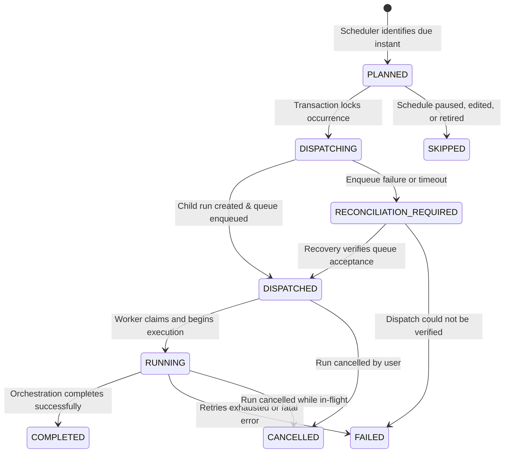

# IDEMPOTENT SCHEDULE OCCURRENCES, LIFECYCLE CONTROLS, AND RECOVERY

**Project:** VerityScout AI  
**Roadmap Phase:** Phase 10 — Research Scheduling and Change Monitoring  
**Step:** 47 of 60  
**Status:** Completed & Verified  
**Governed by:** ADR-002, ADR-004, ADR-010, DATA_CONTRACTS.md  

---

## 1. Domain Model and Relationships

VerityScout AI distinguishes schedule definitions, planned execution occurrences, and the resulting research runs:

```
+-----------------------------------+
|         Research Schedule         |
| - id, task_id, user_id            |
| - revision: number                |
| - status: ACTIVE | PAUSED | ...   |
| - recurrence_rule, scheduled_time |
| - request_snapshot, timezone      |
| - next_run_at                     |
+-----------------+-----------------+
                  | 1
                  |
                  | N
+-----------------v-----------------+
|        Schedule Occurrence        |
| - id: UUID                        |
| - schedule_id: UUID               |
| - user_id: UUID                   |
| - schedule_revision: number       |
| - idempotency_key: VARCHAR(128)   |  <-- UNIQUE(schedule_id, scheduled_at)
| - scheduled_at: TIMESTAMPTZ       |
| - status: OccurrenceStatus        |
| - queue_job_id: UUID | null       |
| - research_run_id: UUID | null    |
| - dispatched_at, started_at       |
| - completed_at, error_message     |
+-----------------+-----------------+
                  | 1
                  |
                  | 0..1
+-----------------v-----------------+
|           Research Run            |
| - id: UUID                        |
| - schedule_id: UUID | null        |
| - status: RunStatus               |
| - synthesis, claims, evidence     |
+-----------------------------------+
```

### Cardinality Guarantees
- **1 Schedule : N Occurrences:** Each execution instant generated by the schedule's recurrence rule produces exactly one durable occurrence record.
- **1 Occurrence : 0..1 Research Runs:** An occurrence produces at most one logical research run under the application's defined dispatch policy.
- Runs are never overwritten to reuse an ID across multiple occurrences. Historical runs remain immutable.

---

## 2. Occurrence Identity and Idempotency Strategy

### 2.1 Deterministic Identity Formula
Every scheduled execution has a deterministic idempotency key computed as:
```ts
idempotency_key = `occ_${schedule_id}_${scheduled_at.toISOString()}`
```

### 2.2 Database Enforcement
In PostgreSQL migration `0009_idempotent_schedule_occurrences.sql`:
1. `uq_schedule_occurrences_schedule_scheduled_at`: `UNIQUE(schedule_id, scheduled_at)`
2. `idempotency_key`: `VARCHAR(128) NOT NULL UNIQUE`
3. Atomic insertion via `ON CONFLICT (schedule_id, scheduled_at) DO UPDATE SET updated_at = schedule_occurrences.updated_at RETURNING *` guarantees that concurrent or repeated scheduler scans retrieve the existing occurrence rather than creating duplicate execution records.

---

## 3. Occurrence State Machine

The occurrence lifecycle transitions across explicit semantic states:



### Transitions
- **`PLANNED`**: Recorded planned execution instant.
- **`DISPATCHING`**: Intermediate transaction state during child run creation and persistent queue submission.
- **`DISPATCHED`**: Job durably accepted by persistent queue; linked to `queue_job_id` and `research_run_id`.
- **`RUNNING`**: Persistent worker has claimed the job and verified that the occurrence is active.
- **`COMPLETED`**: Orchestrator finished and synthesized evidence.
- **`FAILED`**: Pipeline execution permanently failed after retry policy exhaustion.
- **`SKIPPED`**: Intentionally not dispatched (e.g. superseded by schedule edit, schedule paused).
- **`CANCELLED`**: Cancelled by explicit user request.
- **`RECONCILIATION_REQUIRED`**: Enqueue or worker lease was interrupted; requires recovery scan.

---

## 4. Schedule Lifecycle Controls

### 4.1 Pausing (`POST /api/schedules/[id]/pause`)
- Transitions status to `PAUSED`.
- Marks all undispatched (`PLANNED`) occurrences as `SKIPPED` (message: `"Schedule paused by user"`).
- **Safety guarantee:** Does NOT cancel already running research tasks. Running runs complete normally.

### 4.2 Resuming (`POST /api/schedules/[id]/resume`)
- Transitions status to `ACTIVE`.
- Resets `consecutive_failures = 0`.
- Recalculates `next_run_at` relative to current time using Step 46 recurrence logic.
- Bounded catch-up: Dispatches at most 1 immediate run if overdue, avoiding backlog stampedes.

### 4.3 Editing (`PATCH /api/schedules/[id]`)
- Increments `revision` counter (`revision = revision + 1`).
- Optimistic Concurrency: If `expectedRevision` is supplied and does not match the schedule's current revision, returns `409 Conflict`.
- Undispatched `PLANNED` occurrences are marked `SKIPPED` (`"Superseded by schedule revision N+1"`).
- Historical dispatched occurrences retain their original request context snapshot.
- Recalculates `next_run_at` if recurrence rule or timezone was modified.

### 4.4 Retiring (`DELETE /api/schedules/[id]`)
- Soft-deletes definition: sets `status = 'ARCHIVED'` and `next_run_at = NULL`.
- Marks `PLANNED` occurrences as `SKIPPED`.
- **Data retention guarantee:** Preserves all historical occurrences, research runs, candidate results, evidence links, and usage accounting records for audit and compliance.

---

## 5. Recovery and Reconciliation Engine

Integrated into `ResearchRecoveryService`:
1. **Stuck `DISPATCHING` Reconciliation:** Scans occurrences in `DISPATCHING` older than 5 minutes. If `queue_job_id` was written, advances to `DISPATCHED`. If not, marks `RECONCILIATION_REQUIRED`.
2. **Terminal Run Synchronization:** Scans occurrences in `DISPATCHED` or `RUNNING` whose linked `research_runs` record has reached `COMPLETED`, `FAILED`, or `CANCELLED`, updating the occurrence status to match the authoritative run outcome.
3. **Worker Pre-Flight Verification:** Before executing a job, `ResearchWorker` inspects the linked occurrence status. If `CANCELLED` or `SKIPPED`, the worker cancels the claimed job immediately without launching the orchestrator.

---

## 6. Timezone & Daylight Saving Continuity

Step 47 directly reuses Step 46's pure `Intl.DateTimeFormat` recurrence engine (`src/server/schedules/timezone.utils.ts` and `recurrence.service.ts`):
- Timezone rules are preserved across edits, pause, resume, and recovery passes.
- DST spring-forward gaps and fall-back overlaps retain their deterministic resolution semantics without local-time drift or duplicate occurrences.

---

## 7. Security and Access Control

- All schedule lifecycle endpoints (`PATCH`, `DELETE`, `pause`, `resume`, `occurrences`) enforce strict user ownership (`user_id = authContext.userId`).
- Row Level Security (RLS) is enabled on `schedule_occurrences` with policy `p_schedule_occurrences_user_isolation`.
- Stale workers or attempts cannot overwrite occurrence records that have already transitioned to terminal or newer revision states.

