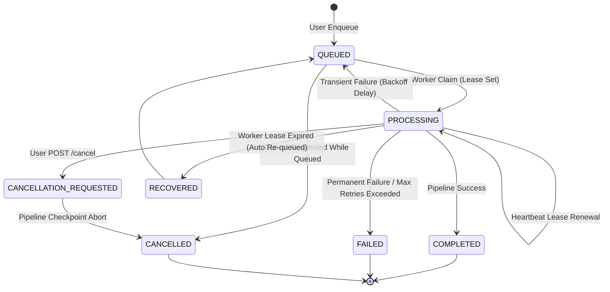

# VerityScout AI — Durable Progress Tracking, Cancellation, Retries, and Recovery

**Phase:** Phase 9 (Model Routing and Asynchronous Research)  
**Step:** 44 of 60  
**Implementation Standard:** Production-grade, durable, concurrency-safe, observable, and regression-tested.

---

## 1. System Overview

Step 44 delivers an enterprise-grade execution lifecycle architecture on top of PostgreSQL-backed asynchronous queues. It equips VerityScout AI with:

1. **Durable Progress Tracking:** Sequential, immutable audit trail of execution events across all research pipeline stages (`PLANNING`, `SEARCHING`, `EXTRACTING`, `VERIFYING`, `SYNTHESIZING`, `FINALIZING`) with monotonic percentage updates.
2. **Cooperative Cancellation:** Graceful abort coordination that stops pipeline execution at predefined checkpoints, handles in-flight operations safely, preserves prior verified evidence, and prevents race conditions with completed runs.
3. **Controlled Retries & Exponential Backoff:** Automated error classification (`TRANSIENT` vs `PERMANENT` vs `CANCELLED`), bounded retry limits, exponential backoff with full jitter, and respectful handling of `Retry-After` headers.
4. **Worker Lease Heartbeats & Dead-Worker Recovery:** Periodic lease renewals during job execution and an autonomous reconciliation service that detects stalled/crashed worker leases and reconciles jobs cleanly without mass resets.

---

## 2. Architecture & Data Contracts

### 2.1 Database Schema (Migration `0006`)

```sql
CREATE TABLE IF NOT EXISTS research_progress_events (
    id UUID PRIMARY KEY DEFAULT gen_random_uuid(),
    run_id UUID NOT NULL REFERENCES research_runs(id) ON DELETE CASCADE,
    user_id UUID NOT NULL,
    stage VARCHAR(50) NOT NULL,
    event_type VARCHAR(50) NOT NULL,
    sequence_number INT NOT NULL,
    message TEXT NOT NULL,
    metadata JSONB NOT NULL DEFAULT '{}'::jsonb,
    created_at TIMESTAMPTZ NOT NULL DEFAULT NOW(),
    CONSTRAINT uq_progress_run_seq UNIQUE (run_id, sequence_number)
);

-- Extensions to research_job_queue
ALTER TABLE research_job_queue ADD COLUMN IF NOT EXISTS lease_expires_at TIMESTAMPTZ NULL;
ALTER TABLE research_job_queue ADD COLUMN IF NOT EXISTS scheduled_at TIMESTAMPTZ NOT NULL DEFAULT NOW();
ALTER TABLE research_job_queue ADD COLUMN IF NOT EXISTS last_error TEXT NULL;
ALTER TABLE research_job_queue ADD COLUMN IF NOT EXISTS failure_category VARCHAR(50) NULL;

-- Queue Dequeue Index
CREATE INDEX idx_research_job_queue_dequeue
ON research_job_queue(priority DESC, scheduled_at ASC)
WHERE status = 'QUEUED';
```

### 2.2 Lifecycle State Transitions



---

## 3. Core Subsystems

### 3.1 Progress Event Repository & Telemetry
- **Sequential Monotonicity:** Atomically calculates `sequence_number = COALESCE(MAX(sequence_number), 0) + 1` scoped per `run_id`.
- **Tenant Isolation:** Enforced via PostgreSQL Row-Level Security (`rls_research_progress_events_tenant`) where `user_id = session.user_id`.
- **Observability:** Granular events (`STAGE_STARTED`, `STAGE_COMPLETED`, `RETRY_SCHEDULED`, `CANCELLATION_REQUESTED`, `CANCELLED`, `RECOVERED`, `FAILED`) allow users to navigate away, return, and reconstruct the exact execution trajectory.

### 3.2 Error Classification & Retry Policy
- **Transient Errors:** HTTP 429 (rate limits), HTTP 502/503/504, network timeouts (`ECONNRESET`, `ETIMEDOUT`, `fetch failed`), and socket dropouts are categorized as `TRANSIENT`.
- **Permanent Errors:** HTTP 400/401/403/404, schema validation errors (`ZodError`), and model capability mismatch are classified as `PERMANENT`.
- **Exponential Backoff:** Calculated via $\min(\text{maxDelay}, \text{baseDelay} \times 2^{\text{attempt} - 1} + \text{jitter})$, capped at 30 seconds by default, respecting upstream `Retry-After` seconds.

### 3.3 Worker Vitality & Recovery
- **Heartbeat:** When a worker claims a job, it establishes a background timer (every 10s) that renews the worker lease by 30 seconds via `queue.renewLease(jobId, 30000)`.
- **Stale Job Reconciliation:** `ResearchRecoveryService.reconcileStaleJobs()` inspects jobs in `PROCESSING` status where `lease_expires_at < NOW()`. If the worker crashed, the service checks attempt counters:
  - If attempts remain: re-queues job with delayed retry and logs `RECOVERED`.
  - If max attempts exhausted: marks run and queue job as `FAILED` and logs `FAILED`.
  - If run had already completed before acknowledgement: acknowledges the queue job cleanly.

---

## 4. API Endpoints

1. **`POST /api/research/runs/[runId]/cancel`**
   - Strictly verifies caller ownership.
   - If `QUEUED`, transitions status directly to `CANCELLED` and marks queue job cancelled.
   - If `RUNNING`, transitions status to `CANCELLATION_REQUESTED` to prompt cooperative abort at the next checkpoint.
   - If `COMPLETED`, returns HTTP 409 Conflict to protect completed work from corruption.

2. **`GET /api/research/runs/[runId]/progress`**
   - Returns durable progress snapshot, `progressPercent` (0–100%), stage counters, and all recorded audit trail events ordered by `sequence_number ASC`.

---

## 5. Verification & Test Evidence

- **Unit Test Suites:**
  - `tests/unit/research-progress.test.ts` (7 tests)
  - `tests/unit/research-cancellation.test.ts` (9 tests)
  - `tests/unit/research-retry-recovery.test.ts` (11 tests)
  - `tests/unit/research-worker.test.ts` (7 tests)
  - `tests/unit/research-queue.test.ts` (11 tests)
  - `tests/unit/research-api.test.ts` (9 tests)
- **Repository Total:** 61 test files, 701 tests passing.
- **Production Build:** Next.js static and dynamic route compilation clean across all 18 routes.

