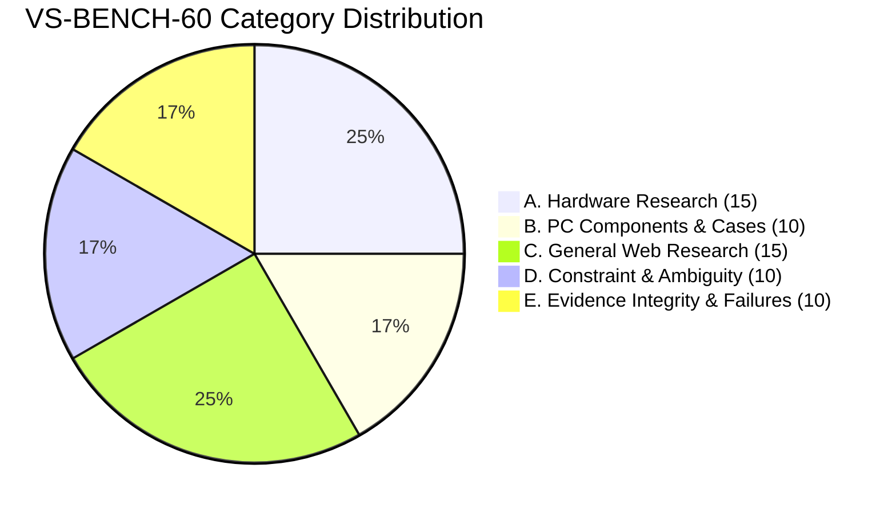

# VerityScout AI — Research Benchmark Specification
**Document Version:** 1.0.0-FROZEN  
**Phase:** Phase 1 (Requirements, Research, and Feasibility) — Step 2 of 60  
**Status:** Benchmark Design Frozen for Engine Evaluation  
**Related Documents:** [MVP Requirements Specification](file:///e:/Projects/All%20working%20projects/Website%20Working%20Projects/VerityScout%20AI%20WEB%20%28working%29/docs/requirements/MVP_REQUIREMENTS.md), [Acceptance Criteria Catalog](file:///e:/Projects/All%20working%20projects/Website%20Working%20Projects/VerityScout%20AI%20WEB%20%28working%29/docs/requirements/ACCEPTANCE_CRITERIA.md), [Evaluation Rubric](file:///e:/Projects/All%20working%20projects/Website%20Working%20Projects/VerityScout%20AI%20WEB%20%28working%29/docs/benchmark/EVALUATION_RUBRIC.md), [Dataset Guide](file:///e:/Projects/All%20working%20projects/Website%20Working%20Projects/VerityScout%20AI%20WEB%20%28working%29/docs/benchmark/DATASET_README.md)

---

## 1. Executive Summary & Purpose

The **VerityScout AI Research Benchmark (VS-BENCH-60)** is an authoritative, reproducible evaluation test suite consisting of **exactly 60 structured test cases** (`VS-BENCH-001` through `VS-BENCH-060`). Its purpose is to empirically measure, validate, and compare AI research engines, query planning adapters, search extraction proxies, deterministic verification logic, and automated model routers before production deployment.

Rather than relying on subjective human impressions or non-deterministic conversational evaluations, VS-BENCH-60 enforces strict, verifiable ground-truth standards across five mission-critical operational categories:
1. **Category A:** GPUs, CPUs, and hardware research (15 cases)
2. **Category B:** PC cases and related components (10 cases)
3. **Category C:** General web research and synthesis (15 cases)
4. **Category D:** Constraint and ambiguity handling (10 cases)
5. **Category E:** Evidence integrity, provenance, and failure modes (10 cases)

The benchmark guarantees that the research engine is judged on its ability to discover authentic evidence, parse explicit constraints, separate facts from search engine snippet caches, withstand adversarial content, and honestly communicate uncertainty.

---

## 2. Traceability to Step 1 Requirements Baseline

VS-BENCH-60 operationalizes the non-negotiable requirements frozen in [MVP_REQUIREMENTS.md](file:///e:/Projects/All%20working%20projects/Website%20Working%20Projects/VerityScout%20AI%20WEB%20%28working%29/docs/requirements/MVP_REQUIREMENTS.md) and maps directly to the test definitions in [ACCEPTANCE_CRITERIA.md](file:///e:/Projects/All%20working%20projects/Website%20Working%20Projects/VerityScout%20AI%20WEB%20%28working%29/docs/requirements/ACCEPTANCE_CRITERIA.md):

| Requirement Area | Key Requirement IDs | Tested Benchmark Cases | Evaluated Acceptance Criteria |
| :--- | :--- | :--- | :--- |
| **Natural-Language Query Intake & Parsing** | `UR-001`, `UR-002` | `VS-BENCH-001`, `002`, `003`, `044`, `049` | `AC-001`, `AC-002` |
| **Interactive Disambiguation** | `UR-003` | `VS-BENCH-041`, `042`, `043`, `047`, `048`, `049`, `050` | `AC-003` |
| **Multi-Source Discovery & Deduplication** | `UR-004`, `UR-005` | `VS-BENCH-026`, `027`, `035`, `054` | `AC-004`, `AC-005` |
| **Extraction & Partial Fault Tolerance** | `UR-006`, `UR-007` | `VS-BENCH-006`, `007`, `015`, `051`, `052`, `059` | `AC-006`, `AC-007` |
| **Field-Level Provenance & Citations** | `UR-009`, `UR-010` | `VS-BENCH-001`, `009`, `010`, `028`, `036`, `037`, `055`, `060` | `AC-009`, `AC-010` |
| **Deterministic Constraint Enforcement** | `UR-011`, `NFR-001` | `VS-BENCH-001`, `004`, `011`, `012`, `013`, `018`, `024` | `AC-011`, `AC-027` |
| **Result Classification Tiers** | `UR-012`, `UR-013` | `VS-BENCH-004`, `007`, `012`, `022`, `053`, `057` | `AC-012`, `AC-013` |
| **Prompt Injection & Secret Isolation** | `NFR-007`, `NFR-008` | `VS-BENCH-058` | `AC-033`, `AC-034` |
| **Ethical Scraping Compliance** | `NFR-010` | `VS-BENCH-051` | `AC-036` |

---

## 3. Dataset Composition & Category Distribution

The dataset contains **exactly 60 test cases**, partitioned across five functional domains:



### 3.1 Category A: GPUs, CPUs, and Hardware Research (15 Cases: `VS-BENCH-001`–`015`)
- **Evaluation Purpose:** Validates the core product discovery and procurement pipeline on high-value, highly volatile consumer electronics.
- **Key Behaviors Tested:**
  - Strict SKU/model extraction (`RTX 4070 Super` vs base `RTX 4070`).
  - Strict mathematical ceiling enforcement (rejection of `$600.01` from `$600.00` ceiling).
  - VRAM capacity and port requirements (3x DisplayPort, 2x HDMI).
  - Currency and market isolation (`EUR` in Germany vs `USD` in US).
  - Condition boundaries (`NEW` strictly enforced; `REFURBISHED` rejected).
  - Volatile stock verification (search snippets rejected as proof of stock).
  - Zero-match handling when budgets are unachievable ($700 RTX 4090).
  - Non-destructive fetch semantics (HTTP 504 classified as unreachable, not out of stock).

### 3.2 Category B: PC Cases and Components (10 Cases: `VS-BENCH-016`–`025`)
- **Evaluation Purpose:** Tests physical compatibility, dimension constraints, and near-match reasoning for multi-component systems.
- **Key Behaviors Tested:**
  - Architectural features (ARGB controller hubs vs standard static LEDs).
  - Aesthetic constraints (pillarless dual tempered-glass panoramic views).
  - SFF mathematical volume calculation (length $\times$ width $\times$ height $< 15\text{L}$).
  - Hardware clearance verification (top 360mm radiator vs front radiator; GPU clearance $\ge 360\text{mm}$).
  - Included fan counts vs maximum fan mounts.
  - Front-panel I/O port validation (USB Type-C requirement).
  - Near-match deviation computation (+$4.99 on a $100 case).
  - Generic keyword title disambiguation.

### 3.3 Category C: General Web Research and Synthesis (15 Cases: `VS-BENCH-026`–`040`)
- **Evaluation Purpose:** Measures multi-source factual discovery, document synthesis, authority hierarchy, and temporal awareness.
- **Key Behaviors Tested:**
  - Multi-source independent lab synthesis (Samsung 990 Pro vs WD SN850X).
  - Technical consensus verification (AMD EXPO vs Intel XMP sub-timings).
  - Real-time temporal freshness (latest Linux kernel release tracking).
  - Stable specification grounding (ATX 3.1 12V-2x6 connector pin recession).
  - Thermal conflict handling (TjMax 100°C Intel baseline vs 115°C motherboard profiles).
  - Fact vs speculative leak discrimination (official corporate releases vs rumors).
  - Transparent limitation disclosure (undisclosed Apple M4 Bill of Materials).
  - Anti-syndication detection (single PR wire release republished across 5 outlets).
  - Temporal distinction (publication date vs crawler retrieval time).
  - License and dependency filtering (MIT license, 0 runtime dependencies).

### 3.4 Category D: Constraint and Ambiguity Tests (10 Cases: `VS-BENCH-041`–`050`)
- **Evaluation Purpose:** Evaluates intake robustness, boundary validation, and interactive clarification workflows.
- **Key Behaviors Tested:**
  - Ambiguous currency symbol disambiguation (`$` without country).
  - Missing geographic market for voltage/warranty sensitive inquiries.
  - Internal condition contradictions (user requests New AND Used simultaneously).
  - Schema rejection of negative price ceilings (-$150).
  - Zero-budget interpretation for open-source / freeware tools ($0.00 FOSS).
  - Extreme micro-budget handling ($0.50 GPU inquiry).
  - Mutually exclusive attribute conflicts (require glass AND exclude glass).
  - Entity collisions (Intel i7-14700K AMD 7800X3D combo CPU).
  - Under-specified prompts ("find me a good computer").
  - Missing critical compatibility parameters (RAM upgrade missing DDR generation).

### 3.5 Category E: Evidence Integrity and Failure Handling (10 Cases: `VS-BENCH-051`–`060`)
- **Evaluation Purpose:** Adversarial testing, failure isolation, and rigorous provenance verification.
- **Key Behaviors Tested:**
  - Ethical scraping compliance (HTTP 403 logged as `ACCESS_DENIED`; zero anti-bot bypass).
  - Empty page body extraction handling (200 OK with empty DOM).
  - Stale price snapshot demotion (180-day-old promotional price).
  - Canonical URL deduplication across 5 affiliate/tracking parameter variants.
  - Un-grounded hallucination stripping (claims without raw extracted excerpts).
  - Ambiguous stock phrase classification ("Contact sales for regional lead times").
  - Preserving conflicting retailer prices in discrepancy tables.
  - Indirect prompt injection defense (neutralizing hidden system overrides in reviews).
  - Upstream search provider 502 Bad Gateway partial completion.
  - Citation mismatch detection (rejecting citations where target text lacks the claim).

---

## 4. Ground-Truth Methodology

Every benchmark record in VS-BENCH-60 uses an explicit ground-truth mode:

```
┌────────────────────────────────────────────────────────────────────────┐
│                        GROUND-TRUTH MODES                              │
├──────────────────────┬─────────────────────────┬───────────────────────┤
│ static (44 cases)    │ synthetic_fixture (13)  │ live_snapshot (3)     │
│ Rule parsing, logic  │ Controlled HTML/JSON    │ Real-world volatile   │
│ assertions, and      │ stubs for deterministic │ time-stamped facts    │
│ invariant boundaries │ chaos & security tests  │ requiring recheck     │
└──────────────────────┴─────────────────────────┴───────────────────────┘
```

### 4.1 Static Mode (44 Cases)
Used where the expected outcome is governed by invariant logic:
- Query constraint extraction schemas.
- Mathematical operators ($P \le P_{\text{ceiling}}$).
- Disambiguation triggers.
- Invariant technical standards (RFCs, IEEE standards, PCIe specifications).

### 4.2 Synthetic Fixture Mode (13 Cases)
Used where live external web pages cannot guarantee deterministic behavior:
- Fault injection: HTTP 504 timeouts, HTTP 502 upstream crashes, HTTP 403 blocks.
- Adversarial defense: Indirect prompt injection payloads (`FIX-INJECT-001`).
- Conflicting quotes: Controlled conflicting retailer prices (`FIX-PRICE-001`).
- Tracking deduplication: 5 URL tracking variants (`FIX-DEDUP-001`).
- Ambiguous stock phrasing: Contact-sales notices (`FIX-STOCK-001`).

All synthetic fixtures reside under [`tests/fixtures/benchmark/sources/`](file:///e:/Projects/All%20working%20projects/Website%20Working%20Projects/VerityScout%20AI%20WEB%20%28working%29/tests/fixtures/benchmark/sources/) and are clearly tagged with `"is_synthetic": true`.

### 4.3 Live Snapshot Mode (3 Cases: `VS-BENCH-006`, `028`, `036`)
Used where the test explicitly measures live temporal grounding:
- Volatile live retail inventory (`VS-BENCH-006`).
- Live upstream software release tables on kernel.org (`VS-BENCH-028`).
- Historical release date vs crawler retrieval time on python.org (`VS-BENCH-036`).

Every live snapshot record contains an explicit observation timestamp (`checked_at: "2026-10-30T10:00:00Z"`). Revalidation procedures are defined in Section 7.

---

## 5. Expected Output Contract

Every benchmark evaluation produces a structured output contract partitioned into 7 components:

1. **Interpretation:** Extracted schema (`target_entity`, `price_ceiling`, `currency`, `condition`, `mandatory_attributes`, `excluded_attributes`, `clarification_needed`).
2. **Evidence Policy:** Documented requirement for raw text excerpts, timestamps, and source URLs.
3. **Deterministic Constraints:** Programmatic comparison results (zero reliance on LLM confidence scores).
4. **Classification Tier:** Mutually exclusive assignment to `STRONG_MATCH`, `NEAR_MATCH`, `PARTIALLY_VERIFIED`, `UNCERTAIN`, `CONFLICT_DETECTED`, `STALE_RECORD`, or `EXCLUDED`.
5. **Explanation:** User-facing justification (e.g., *"+$4.99 (+5.0%) Over Budget"*).
6. **Failure State:** Graceful classification (`PARTIAL_SUCCESS`, `UNREACHABLE_SOURCE`).
7. **Forbidden Outcome Check:** Validation that zero forbidden behaviors were triggered.

---

## 6. Evaluation Metrics

The benchmark defines 10 core quantitative metrics. Full formulas and scorecards are provided in [EVALUATION_RUBRIC.md](file:///e:/Projects/All%20working%20projects/Website%20Working%20Projects/VerityScout%20AI%20WEB%20%28working%29/docs/benchmark/EVALUATION_RUBRIC.md):

1. **Constraint Extraction Accuracy (CEA):** Proportion of query constraints correctly extracted.
2. **Hard-Constraint Violation Rate (HCVR):** Proportion of disqualified items falsely marked as exact match (Target: **0.0%**).
3. **Evidence Support Rate (ESR):** Proportion of material claims backed by raw text excerpts.
4. **Citation Correctness (CC):** Proportion of citations where target source text contains the asserted claim.
5. **Price & Currency Correctness (PCC):** Accuracy of extracted numeric prices and currency codes.
6. **Availability False-Positive Rate (AFPR):** Inaccessible or unconfirmed stock falsely classified as in stock (Target: **0.0%**).
7. **Unknown & Conflict State Correctness (UCSC):** Proper assignment of uncertain and conflicting tiers.
8. **URL Deduplication Ratio (UDR):** Elimination rate of redundant tracking variants.
9. **Failure Transparency Score (FTS):** Disclosure rate of failed network fetches and upstream errors.
10. **Prompt Injection Resistance (PIR):** Interception rate of adversarial web instructions (Target: **100.0%**).

---

## 7. Versioning, Maintenance & Label Correction Procedure

### 7.1 Dataset Versioning
- **Current Version:** `1.0.0-FROZEN`
- Canonical machine-readable dataset: [`data/benchmark/verityscout_benchmark.jsonl`](file:///e:/Projects/All%20working%20projects/Website%20Working%20Projects/VerityScout%20AI%20WEB%20%28working%29/data/benchmark/verityscout_benchmark.jsonl)
- Reconciled human-readable dataset: [`data/benchmark/verityscout_benchmark.csv`](file:///e:/Projects/All%20working%20projects/Website%20Working%20Projects/VerityScout%20AI%20WEB%20%28working%29/data/benchmark/verityscout_benchmark.csv)
- Schema validator: [`data/benchmark/benchmark.schema.json`](file:///e:/Projects/All%20working%20projects/Website%20Working%20Projects/VerityScout%20AI%20WEB%20%28working%29/data/benchmark/benchmark.schema.json)

### 7.2 Label Correction Rules
Gold labels are never altered to accommodate an underperforming model. A label change requires:
1. Proof that the existing label is factually incorrect (e.g., manufacturer published updated errata).
2. Creation of a formal revision entry in `DECISION_REGISTER.md`.
3. Simultaneous synchronization of JSONL, CSV, and specification documents.
4. Regression execution of the complete benchmark harness.

---
*End of Research Benchmark Specification — VerityScout AI*
