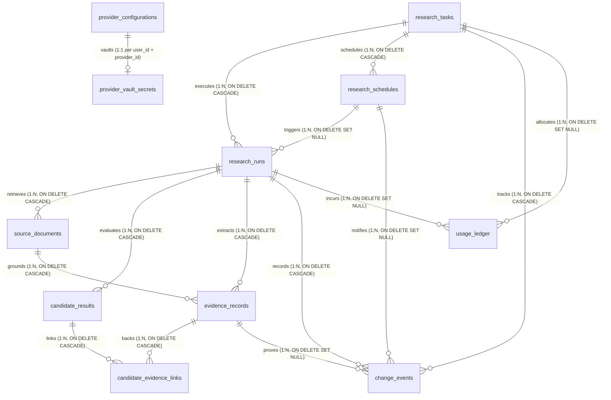

# Database Schema Entity-Relationship & Provenance Architecture

**Document Identifier:** VS-DB-RELATIONSHIPS-v1.0  
**Phase:** Phase 5 of 12 (Data Persistence & PostgreSQL Schema Architecture)  
**Step:** 21 of 60  
**Status:** APPROVED ARCHITECTURAL SPECIFICATION  
**Governing Documents:** `ADR-003`, `ADR-007`, `ADR-008`, `DATA_CONTRACTS.md`

---

## 1. Master Entity-Relationship Diagram



---

## 2. Cardinality & Foreign Key Cascade Rules

| Parent Table | Child Table | Relationship | Foreign Key Column | Delete Action | Lifecycle & Privacy Rationale |
|---|---|---|---|---|---|
| `research_tasks` | `research_runs` | 1 to Many | `task_id` | `ON DELETE CASCADE` | Deleting a task cleanly purges all historical execution runs (`SEC-033`). |
| `research_tasks` | `research_schedules` | 1 to Many | `task_id` | `ON DELETE CASCADE` | Removing a task cancels all associated recurring cron triggers. |
| `research_tasks` | `change_events` | 1 to Many | `task_id` | `ON DELETE CASCADE` | Change history is strictly bound to the parent task lifecycle. |
| `research_schedules` | `research_runs` | 1 to Many | `schedule_id` | `ON DELETE SET NULL` | Deleting a schedule retains past execution run telemetry. |
| `research_runs` | `source_documents` | 1 to Many | `run_id` | `ON DELETE CASCADE` | Discovered web documents belong exclusively to the execution run. |
| `research_runs` | `candidate_results` | 1 to Many | `run_id` | `ON DELETE CASCADE` | Candidate evaluations are atomic to the run. |
| `research_runs` | `evidence_records` | 1 to Many | `run_id` | `ON DELETE CASCADE` | Factual claims belong to the execution run. |
| `source_documents` | `evidence_records` | 1 to Many | `source_id` | `ON DELETE CASCADE` | Evidence cannot exist without its grounding source document. |
| `candidate_results` | `candidate_evidence_links` | 1 to Many | `candidate_id` | `ON DELETE CASCADE` | Normalized junction link cascade. |
| `evidence_records` | `candidate_evidence_links` | 1 to Many | `evidence_id` | `ON DELETE CASCADE` | Normalized junction link cascade. |
| `research_tasks` | `usage_ledger` | 1 to Many | `task_id` | `ON DELETE SET NULL` | Immutable financial ledger retains cost audit records even if task is deleted (`UR-024`). |
| `research_runs` | `usage_ledger` | 1 to Many | `run_id` | `ON DELETE SET NULL` | Financial ledger retains provider token records even if run is purged. |

---

## 3. Provenance & Claim-to-Evidence Traceability Chain

VerityScout AI's deterministic verification engine enforces strict traceability from findings to sources:

```text
[User Research Task] (research_tasks)
       │
       ▼
[Research Run] (research_runs)
       │
       ├─────────────────────────────────┐
       ▼                                 ▼
[Source Document] (source_documents)   [Candidate Result] (candidate_results)
(URL, Domain, Retrieval Timestamp)       (Match Classification, Specs)
       │                                         ▲
       ▼                                         │
[Evidence Record] (evidence_records)             │
(Verbatim Quote, Verification State)             │
       │                                         │
       └─────► [candidate_evidence_links] ───────┘
```

### Traceability Invariants:
1. **No Orphan Evidence:** An evidence record must have a valid `source_id` pointing to an existing `source_documents` row.
2. **Normalized Multi-Candidate Association:** A single evidence record (e.g., Lenovo official PSREF RAM specification) can support multiple candidate offerings via `candidate_evidence_links` without duplicating evidence records or embedding unstructured string arrays.
3. **Immutable Financial Audit:** The `usage_ledger` references `task_id` and `run_id` using `ON DELETE SET NULL`. If a user deletes a research run or task, the audit trail of token consumption, search query costs, and financial debits remains preserved for reconciliation.
