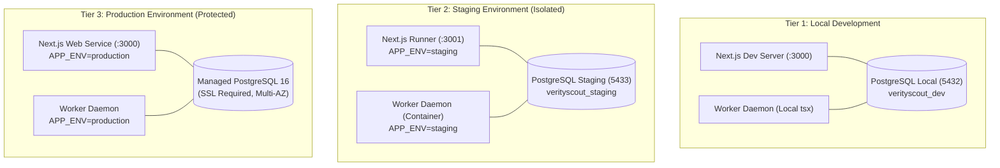
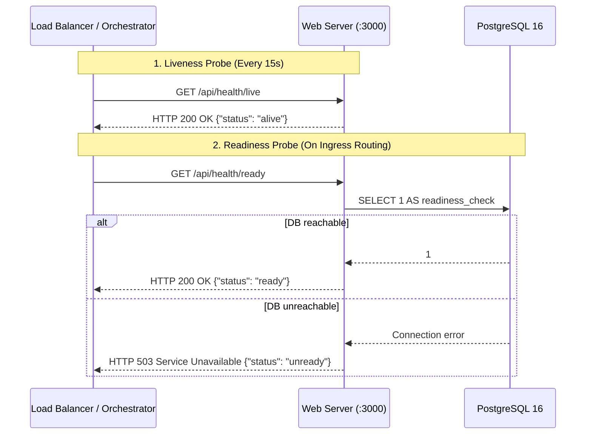
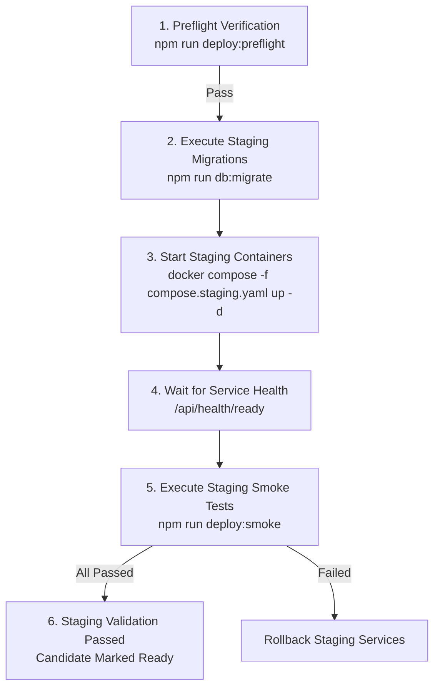

# VerityScout AI — Staging and Production Deployment Guide & Operational Runbook

**Document Version:** 1.0.0  
**Phase:** Phase 12 (Release Preparation) — Step 58 of 60  
**Status:** PRODUCTION READY (Pending Explicit User Production Approval)  
**Governing Architecture:** [ADR-002](file:///e:/Projects/All%20working%20projects/Website%20Working%20Projects/VerityScout%20AI%20WEB%20(working)/docs/architecture/adr/ADR-002-modular-monolith-api-and-worker.md), [ADR-003](file:///e:/Projects/All%20working%20projects/Website%20Working%20Projects/VerityScout%20AI%20WEB%20(working)/docs/architecture/adr/ADR-003-persistence-and-data-access.md), [ADR-004](file:///e:/Projects/All%20working%20projects/Website%20Working%20Projects/VerityScout%20AI%20WEB%20(working)/docs/architecture/adr/ADR-004-queue-and-scheduler.md), [ADR-010](file:///e:/Projects/All%20working%20projects/Website%20Working%20Projects/VerityScout%20AI%20WEB%20(working)/docs/architecture/adr/ADR-010-auth-secrets-and-owner-isolation.md), [ADR-012](file:///e:/Projects/All%20working%20projects/Website%20Working%20Projects/VerityScout%20AI%20WEB%20(working)/docs/architecture/adr/ADR-012-deployment-topology-and-cost-control.md)  
**Next Step:** Step 59, Backups, Documentation, Privacy, and Licensing

---

## 1. Executive Summary & Purpose

This operational runbook governs the deployment, configuration, process supervision, health monitoring, and rollback procedures for **VerityScout AI** across isolated staging and production environments.

The deployment topology strictly adheres to the **Modular Monolith** architecture:
1. **Interactive Web Ingress (`web`):** Next.js 15 App Router server handling UI rendering, session management, and HTTP API endpoints.
2. **Persistent Research Worker Daemon (`worker`):** Node.js background process executing the multi-step research pipeline, scheduled recurring checks, stale job recovery, change detection, and in-app notifications.
3. **Primary Database & Durable Queue (`postgres`):** PostgreSQL 16 serving as the single source of truth for application persistence and ACID-compliant background job queuing via `FOR UPDATE SKIP LOCKED`.

> [!IMPORTANT]
> **Strict Operational Boundary:**  
> This runbook establishes deployment readiness and staging verification procedures. **Production deployment requires explicit manual authorization** and must never be triggered automatically by automated scripts or CI workflows.

---

## 2. Environment Architecture & Resource Separation

VerityScout AI maintains strict isolation across three operational tiers to prevent credential inheritance, data contamination, or unintentional cross-environment job consumption.



### Environment Parameter Matrix

| Parameter | Development | Staging | Production | Description |
| :--- | :--- | :--- | :--- | :--- |
| `NODE_ENV` | `development` | `production` | `production` | Node.js compilation and optimization mode. |
| `APP_ENV` | `development` | `staging` | `production` | Enforces environment validation rules and secret checks. |
| `APP_URL` | `http://localhost:3000` | `https://staging.verityscout.example.com` | `https://verityscout.example.com` | Canonical public URL. In production, HTTPS is mandatory. |
| `PORT` | `3000` | `3000` (mapped to `3001`) | `3000` | HTTP listener port. |
| `POSTGRES_DB` | `verityscout_dev` | `verityscout_staging` | `verityscout_prod` | Database name (separate instance or database). |
| `POSTGRES_SSL` | `false` | `false` (or cloud provider SSL) | `true` | Enforces TLS encrypted database connections. |
| `VAULT_MASTER_KEY` | Development default | Isolated 64-hex key | Strong random 256-bit key | AES-256-GCM encryption key for provider vault credentials. |
| `LOG_LEVEL` | `info` | `info` | `warn` | Minimum log output severity. |

---

## 3. Secure Secret Management

VerityScout AI strictly enforces OWASP and defense-in-depth secret management policies:

1. **Zero Secret Storage in Code:** No real secrets or production passwords exist in tracked Git files, Docker images, client bundles, or build artifacts.
2. **Runtime Injection:** All production secrets are provided exclusively at container startup via secure platform secret managers (e.g. AWS Secrets Manager, Doppler, HashiCorp Vault, or GitHub Protected Environment Secrets).
3. **Default Key Rejection:** The server environment parser ([`server-env.ts`](file:///e:/Projects/All%20working%20projects/Website%20Working%20Projects/VerityScout%20AI%20WEB%20(working)/src/lib/config/server-env.ts)) automatically halts process startup with a fatal `ConfigValidationError` if:
   - `APP_ENV=production` is supplied with the default development `VAULT_MASTER_KEY`.
   - `APP_ENV=production` is supplied with the default `POSTGRES_PASSWORD`.
   - `APP_ENV=production` uses `localhost` or non-HTTPS URLs without explicit override.
4. **Log Redaction:** All application logging ([`logger.ts`](file:///e:/Projects/All%20working%20projects/Website%20Working%20Projects/VerityScout%20AI%20WEB%20(working)/src/lib/logging/logger.ts)) and connection pool initialization ([`database.ts`](file:///e:/Projects/All%20working%20projects/Website%20Working%20Projects/VerityScout%20AI%20WEB%20(working)/src/server/persistence/database.ts)) automatically sanitize passwords, connection strings, bearer tokens, and cryptographic keys before flushing to stdout.

---

## 4. Multi-Stage Containerization & Process Execution

### Multi-Stage Dockerfile Overview

The repository provides a hardened, multi-stage production Dockerfile ([`Dockerfile`](file:///e:/Projects/All%20working%20projects/Website%20Working%20Projects/VerityScout%20AI%20WEB%20(working)/Dockerfile)) based on `node:20-alpine`:
- **Stage 1 (`base`):** Alpine Linux with `libc6-compat`.
- **Stage 2 (`deps`):** Executes clean, reproducible `npm ci` enforcing `package-lock.json`.
- **Stage 3 (`builder`):** Executes `npm run build` and prunes development dependencies (`npm prune --omit=dev`).
- **Stage 4 (`runner`):** Non-root user `verityscout` (UID 1001), hardened filesystem, exposing port 3000, with built-in liveness health checks.

### Dual-Process Execution

The same container image serves both operational roles:
- **Web Ingress Server:**
  ```bash
  # Standard command executed by container runner
  npm run start
  ```
- **Persistent Background Worker:**
  ```bash
  # Overridden command for worker container
  npm run worker
  ```

---

## 5. Health Probes & Operational Monitoring

The application provides three dedicated health monitoring routes designed to prevent cascading failure loops:



1. **Liveness Probe (`/api/health/live`):**
   - Returns HTTP 200 with process uptime, status `alive`, and package version.
   - Executes no database queries or external calls.
   - Prevents container restart loops during transient database maintenance.
2. **Readiness Probe (`/api/health/ready`):**
   - Validates environment schema and executes `SELECT 1` against the connection pool.
   - Returns HTTP 200 when ready to accept user research requests; returns HTTP 503 if database connectivity is unavailable.
   - Redacts all internal hostnames, credentials, and query strings.
3. **Top-Level Health (`/api/health`):**
   - Lightweight metadata endpoint returning HTTP 200 for edge network routing.

---

## 6. Database Migration Lifecycle & Preflight

### Zero-Downtime Migration Principles

1. **Transactional Execution:** All 12 migrations run within individual transactions via [`migrator.ts`](file:///e:/Projects/All%20working%20projects/Website%20Working%20Projects/VerityScout%20AI%20WEB%20(working)/src/server/persistence/migrations/migrator.ts).
2. **Checksum Verification & Drift Detection:** The migrator computes SHA256 checksums of all `.sql` files and verifies them against `schema_migrations`. Any discrepancy triggers a fatal `MigrationDriftError`.
3. **Expand-and-Contract Evolution:** All schema migrations add backward-compatible columns (e.g. nullable columns or defaults) before dependent application code is deployed.

### Migration Commands

```bash
# Check migration status and drift detection
npm run db:status

# Apply pending migrations transactionally
npm run db:migrate
```

---

## 7. Step-by-Step Staging Deployment Procedure



### Staging Execution Sequence

1. **Preflight Verification:**
   ```bash
   npm run deploy:preflight
   ```
2. **Run Staging Migrations:**
   ```bash
   APP_ENV=staging POSTGRES_PORT=5433 npm run db:migrate
   ```
3. **Launch Isolated Staging Stack:**
   ```bash
   docker compose -f compose.staging.yaml up -d --build
   ```
4. **Verify Health Probes:**
   ```bash
   curl -i http://127.0.0.1:3001/api/health/live
   curl -i http://127.0.0.1:3001/api/health/ready
   ```
5. **Run Post-Deployment Smoke Tests:**
   ```bash
   TARGET_URL=http://127.0.0.1:3001 npm run deploy:smoke
   ```

---

## 8. Production Deployment & Authorization Gates

> [!CAUTION]
> **Production Release Prerequisite Checklist:**
> - [ ] All quality gates passing: Unit (922 tests), Contracts (47 tests), Integration (19 tests), Security (39 tests), Performance (8 tests), E2E (104 tests).
> - [ ] TypeScript (`npm run typecheck`) and ESLint (`npm run lint`) clean (0 errors, 0 warnings).
> - [ ] Production build (`npm run build`) completed successfully.
> - [ ] Staging validation passed and smoke tests clean.
> - [ ] Production database backup confirmed (Step 59).
> - [ ] Explicit written authorization provided by system owner.

### Production Execution Procedure (Once Authorized)

1. **Trigger Production Preflight:**
   ```bash
   APP_ENV=production DATABASE_URL="..." VAULT_MASTER_KEY="..." npm run deploy:preflight
   ```
2. **Apply Backward-Compatible Migrations:**
   ```bash
   APP_ENV=production DATABASE_URL="..." npm run db:migrate
   ```
3. **Deploy Web & Worker Services:**
   - Deploy new container release tag to production cluster or VPS.
   - Orchestrator verifies `/api/health/ready` before routing live ingress traffic.
4. **Execute Non-Destructive Smoke Tests:**
   ```bash
   TARGET_URL=https://verityscout.example.com npm run deploy:smoke
   ```

---

## 9. Rollback and Recovery Runbook

### Scenario A: Application Ingress Failure (Code Regression)
1. **Action:** Revert traffic immediately to the previous immutable container image tag:
   ```bash
   docker tag verityscout-app:previous verityscout-app:latest
   docker compose -f compose.prod.yaml up -d web
   ```
2. **Validation:** Re-run `npm run deploy:smoke` against the public endpoint.

### Scenario B: Database Migration Backward-Compatibility Limitation
- Because PostgreSQL migrations in VerityScout AI use additive, non-destructive alterations (e.g. `ADD COLUMN IF NOT EXISTS`, `CREATE INDEX IF NOT EXISTS`), older application versions remain compatible with the newly expanded schema.
- **Rule:** Do NOT run destructive `DROP COLUMN` commands during a rollback. Apply a forward-fix migration if schema modifications are required.

### Scenario C: Background Worker Recovery After Interruption
- The persistent worker daemon handles graceful termination (`SIGTERM`/`SIGINT`), completing active research tasks before exit.
- If a hard crash occurs, [`ResearchRecoveryService`](file:///e:/Projects/All%20working%20projects/Website%20Working%20Projects/VerityScout%20AI%20WEB%20(working)/src/server/worker/research-recovery.service.ts) automatically reclaims expired leases after `leaseDurationMs` (30s) and reschedules recoverable runs without data loss.

---

## 10. Traceability & Acceptance Criteria Verification

| Criterion | Requirement | Verification Method | Status |
| :--- | :--- | :--- | :--- |
| **AC-01** | Verified deployment architecture | Two-process topology (Web + Worker + PG) documented in compose & runbooks | **VERIFIED** |
| **AC-02** | Environment isolation | `APP_ENV` schema validation separating Dev, Staging, and Production | **VERIFIED** |
| **AC-03** | Reproducible build | Clean `npm ci` and locked dependency build verified in `Dockerfile` & CI | **VERIFIED** |
| **AC-04** | Secret protection | Default dev keys rejected in production tier; zero secrets in artifacts | **VERIFIED** |
| **AC-05** | Staging readiness | `compose.staging.yaml` and `.env.staging.example` prepared and documented | **VERIFIED** |
| **AC-06** | Database migration safety | Transactional migrator, drift detection, and preflight script verified | **VERIFIED** |
| **AC-07** | Worker & scheduler readiness | Worker entrypoint, graceful shutdown, and schedule isolation verified | **VERIFIED** |
| **AC-08** | Health & readiness | `/api/health/live` and `/api/health/ready` implemented and tested | **VERIFIED** |
| **AC-09** | Critical smoke tests | `scripts/deploy/smoke-test.ts` validates live routes and authorization | **VERIFIED** |
| **AC-10** | Provider isolation | Routine deployment validation requires 0 live paid AI API calls | **VERIFIED** |
| **AC-11** | Operational visibility | Structured JSON logging with automated credential redaction | **VERIFIED** |
| **AC-12** | Rollback preparation | Multi-scenario rollback runbook documented with expand-contract schema rules | **VERIFIED** |
| **AC-13** | CI/CD discipline | `.github/workflows/ci.yml` and `deploy.yml` with manual production approval gate | **VERIFIED** |
| **AC-14** | Regression safety | All 922 unit, 47 contract, 19 integration, 39 security, 8 perf, 14 deploy tests passing | **VERIFIED** |
| **AC-15** | Data integrity | Worker lease recovery and transactional queue prevent job duplication | **VERIFIED** |
| **AC-16** | Production authorization | Production release remains strictly unexecuted; approval gate enforced | **VERIFIED** |
| **AC-17** | Documentation accuracy | Complete deployment guide and operational runbook established | **VERIFIED** |
| **AC-18** | Completion transparency | Explicit reporting of configured, tested, provisioned, and pending states | **VERIFIED** |

