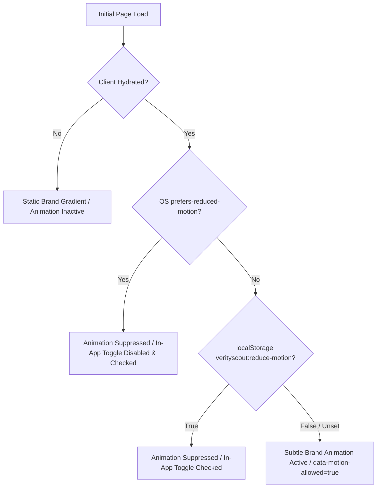

# VerityScout AI — Motion Policy & Accessible Animation Control

**Document Identifier:** VS-MOTION-POLICY-v1.0  
**Status:** APPROVED MOTION & ACCESSIBILITY SPECIFICATION  
**Phase:** Phase 3 (Step 12 of 60)  
**Governed by:** [ADR-001: Frontend Architecture & TypeScript Unification Strategy](file:///e:/Projects/All%20working%20projects/Website%20Working%20Projects/VerityScout%20AI%20WEB%20(working)/docs/architecture/adr/ADR-001-frontend-and-typescript.md), [DESIGN_TOKENS.md](file:///e:/Projects/All%20working%20projects/Website%20Working%20Projects/VerityScout%20AI%20WEB%20(working)/docs/design-system/DESIGN_TOKENS.md)  
**Accessibility Standards:** WCAG 2.2 Level AA (SC 2.2.2 Pause, Stop, Hide; SC 2.3.3 Animation from Interactions; SC 1.4.3 Contrast Minimum; SC 2.4.7 Focus Visible)

---

## 1. Purpose & Visual Motion Direction

VerityScout AI is an evidence-first, autonomous web research and deterministic verification engine. The platform prioritizes calm, distraction-free concentration during deep technical investigations.

Motion within the interface is strictly governed by the following motion tenets:
- **Restrained & Intentional:** Non-essential animation is confined exclusively to subtle brand identity treatments. It must never distract from research evidence, data tables, or source citations.
- **Zero Layout Shifts:** Animation must never alter element dimensions, padding, margins, font sizing, or positioning. Layout geometry remains completely identical whether animation is active, paused, or disabled.
- **Decoupled from Information:** Motion is purely decorative. Animation must never be the sole carrier of application state, job status, verification outcomes, error reporting, or confidence scores.
- **Accessibility by Default:** Operating system preferences (`prefers-reduced-motion: reduce`) are strictly respected at all times, with additional in-app controls for user autonomy.

---

## 2. Animated Brand Treatment Specification

### 2.1 Target Region & Visual Implementation
The dynamic brand transition is applied exclusively to the main title text gradient on the startup page (`.title` in [`src/app/page.module.css`](file:///e:/Projects/All%20working%20projects/Website%20Working%20Projects/VerityScout%20AI%20WEB%20(working)/src/app/page.module.css)).

```css
.title {
  font-size: var(--font-size-3xl);
  font-weight: var(--font-weight-bold);
  letter-spacing: var(--letter-spacing-tight);
  margin-bottom: var(--space-2);
  background: linear-gradient(
    135deg,
    var(--palette-slate-50) 0%,
    var(--palette-slate-50) 25%,
    var(--color-accent-cyan) 50%,
    var(--color-accent-violet) 75%,
    var(--color-accent-cyan) 100%
  );
  background-size: 200% 200%;
  background-position: 0% 50%;
  -webkit-background-clip: text;
  -webkit-text-fill-color: transparent;
}
```

### 2.2 CSS Keyframe & Timing Tokens
The animation shifts the background position of the text clip gradient across a smooth, slow 14-second loop:

```css
:root {
  --motion-duration-brand: 14s;
  --motion-easing-brand: ease-in-out;
}

@keyframes brandGradientShift {
  0% {
    background-position: 0% 50%;
  }
  50% {
    background-position: 100% 50%;
  }
  100% {
    background-position: 0% 50%;
  }
}
```

### 2.3 Static Fallback State
When motion is disabled (via OS setting or in-app preference), the title renders at static `background-position: 0% 50% !important;` with `animation: none !important;`. The resulting static gradient is identical to the verified Step 11 baseline, preserving complete visual polish and high contrast ($\ge 16.96:1$).

---

## 3. Two-Tier Motion Preference Hierarchy

VerityScout AI implements an authoritative two-tier motion preference policy:

$$\text{Effective Motion Allowed} = (\text{System Allows Motion}) \land (\text{User Allows Motion}) \land (\text{Client Initialized})$$



### 3.1 Tier 1: Operating System Precedence (`prefers-reduced-motion`)
The operating system preference is authoritative and cannot be overridden by in-app settings:
1. Native CSS `@media (prefers-reduced-motion: reduce)` immediately clamps all animation durations to `0.01ms` and sets `--motion-duration-brand: 0s !important`, ensuring zero motion even before JavaScript executes.
2. In the React interface, if `prefers-reduced-motion: reduce` is detected via `matchMedia`, the in-app checkbox is displayed in a checked and disabled state with supporting text: *"System preference active (Reduce motion enabled in OS)"*.
3. Dynamic changes to the OS media query are tracked via `mediaQuery.addEventListener('change', ...)` and take effect immediately.

### 3.2 Tier 2: In-App User Control (`ReduceMotionControl`)
For users on devices where system-level reduced motion is not configured, the in-app control provides direct autonomy:
- Located within the application card ([`src/components/motion/ReduceMotionControl.tsx`](file:///e:/Projects/All%20working%20projects/Website%20Working%20Projects/VerityScout%20AI%20WEB%20(working)/src/components/motion/ReduceMotionControl.tsx)).
- Built with native HTML checkbox semantics (`<input type="checkbox">` wrapped in `<label>`).
- Full keyboard accessibility: reachable via <kbd>Tab</kbd>, toggleable via <kbd>Space</kbd>.
- High-contrast visible focus outline (`outline: var(--border-width-md) solid var(--color-focus-ring)`).
- Clear accessible name: *"Reduce motion"*, with programmatic description via `aria-describedby="reduce-motion-hint"`.

---

## 4. Preference Persistence & Hydration Safety

1. **Storage Key:** Saved in `localStorage` under the namespaced key `verityscout:reduce-motion` as `'true'` or `'false'`.
2. **Hydration Protection:** During initial server rendering, no browser APIs (`window`, `localStorage`, `matchMedia`) are accessed. The animation remains inactive on initial SSR to eliminate any flash of motion.
3. **DOM State Synchronization:** The client component sets root HTML attributes:
   - When motion is allowed: `document.documentElement.setAttribute('data-motion-allowed', 'true')`
   - When motion is reduced: `document.documentElement.setAttribute('data-reduce-motion', 'true')`
4. **Resilience & Storage Failures:** If `localStorage` access is restricted (e.g. strict private browsing or disabled cookies), `try/catch` guards ensure the component falls back safely to in-memory state without throwing errors or crashing.

---

## 5. Verification & Test Evidence

The motion policy and components are validated across 5 unit tests and 6 specialized end-to-end browser tests:

| Test ID | Scope | Verification Method | Result |
|---|---|---|---|
| `UNIT-001` | Component Rendering | Renders accessible checkbox with label "Reduce motion" | **PASS** |
| `UNIT-002` | State Toggle | Toggles state, updates localStorage, and synchronizes DOM attributes | **PASS** |
| `UNIT-003` | Storage Read | Reads and applies saved `localStorage` preference on mount | **PASS** |
| `UNIT-004` | OS Precedence | Disables checkbox and suppresses motion when OS requests reduction | **PASS** |
| `UNIT-005` | Storage Resilience | Gracefully degrades without exceptions when localStorage is blocked | **PASS** |
| `MOTION-E2E-001` | Default Animation | Initial page load sets `data-motion-allowed="true"` under normal motion | **PASS** |
| `MOTION-E2E-002` | System Override | Emulating `reducedMotion: 'reduce'` suppresses animation immediately | **PASS** |
| `MOTION-E2E-003` | User Toggle | Clicking toggle sets `data-reduce-motion="true"` without page reload | **PASS** |
| `MOTION-E2E-004` | Persistence | Toggle state persists after full browser reload | **PASS** |
| `MOTION-E2E-005` | System Precedence | System `reduce` overrides previously saved user preference | **PASS** |
| `MOTION-E2E-006` | Keyboard & Focus | Full keyboard interaction via Space key with visible focus outline | **PASS** |

---

## 6. Rules for Future Animated Features

Any non-essential animation introduced in subsequent roadmap steps (Phases 3 through 12) must adhere to the following rules:
1. Must consume motion duration and easing tokens from `globals.css`.
2. Must be wrapped in `:global(html[data-motion-allowed="true"])` selectors or automatically disabled under `html[data-reduce-motion="true"]`.
3. Must include a static fallback state that preserves complete layout, readability, and contrast.
4. Must never be the sole indicator of dynamic status, errors, or progress.
