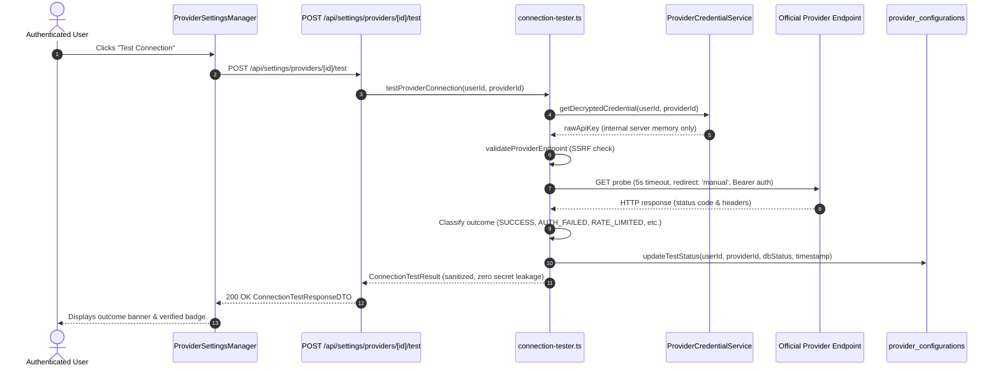

# AI Provider Settings and Connection Tests

## 1. Overview and Architecture Standard

Governed by **Step 26** of the 60-step roadmap (Phase 6: AI Providers), this document defines the user-facing provider settings configuration, secure BYOK (Bring Your Own Key) credential lifecycle, and explicit connection verification subsystem for **VerityScout AI**.

### Core Engineering Principles
1. **Separation of Concerns:** Provider configuration, secret storage, provider connection testing, and AI inference are strictly decoupled. Saving a credential does not verify its validity. Successfully storing a credential never marks a provider as verified. A verified connection test does not imply all catalog models are available or authorize unapproved cost.
2. **Zero Billable Model Invocations:** Connection testing probes use official, lightweight, non-inference metadata endpoints. No LLM prompts, token completions, or generative models are invoked during connection testing.
3. **Hardware-Accelerated Encryption Boundary:** Credentials submitted via the settings UI are encrypted server-side with AES-256-GCM authenticated encryption via Step 25's `ProviderCredentialService` before persistence in PostgreSQL vault secrets. Plaintext credentials are never echoed to clients or stored in browser memory.
4. **Strict SSRF & Redirect Defenses:** All connection tests execute against a hardcoded, official HTTPS endpoint allowlist with a strict 5-second timeout and manual redirect handling (`redirect: 'manual'`) to prevent token leakage across third-party domains.

---

## 2. Supported AI Providers

The baseline AI provider ecosystem for Phase 6 consists of three frontier synthesis engines:

| Provider Identifier | Display Name | Category | Official Test Probe Endpoint | Method | Authentication Scheme | Purpose / Capability |
| :--- | :--- | :--- | :--- | :--- | :--- | :--- |
| `openai` | **OpenAI** | Primary AI Model | `https://api.openai.com/v1/models` | `GET` | `Authorization: Bearer <key>` | Industry standard frontier reasoning & structured output (GPT-4o, o1). |
| `openrouter` | **OpenRouter** | Multi-Model Router | `https://openrouter.ai/api/v1/auth/key` | `GET` | `Authorization: Bearer <key>` | Universal multi-model gateway with dynamic fallback & routing. |
| `nim` | **NVIDIA NIM** | High-Performance Inference | `https://integrate.api.nvidia.com/v1/models` | `GET` | `Authorization: Bearer <key>` | Hardware-accelerated microservices (Llama 3.3, Mistral, Nemotron). |

### Official Documentation References
- **OpenAI:** [OpenAI API Reference — List Models](https://platform.openai.com/docs/api-reference/models/list)
  - Endpoint: `GET /v1/models`
  - Validates API key authentication without incurring usage or generation charges.
- **OpenRouter:** [OpenRouter API Documentation — Check API Key](https://openrouter.ai/docs/api-reference/overview)
  - Endpoint: `GET /api/v1/auth/key`
  - Official lightweight auth probe returning key status, rate limits, and credit balances.
- **NVIDIA NIM:** [NVIDIA API Catalog & Microservices Reference](https://build.nvidia.com)
  - Endpoint: `GET https://integrate.api.nvidia.com/v1/models`
  - Standard OpenAI-compatible model listing probe hosted on official NVIDIA Build infrastructure.

---

## 3. Configuration Management & CRUD Operations

### 3.1 Listing Configurations (`GET /api/settings/providers`)
- Authenticates caller using `requireAuthenticatedCaller()`.
- Retrieves user's configuration metadata rows from `provider_configurations`.
- Combines with the 3 baseline supported providers (`openai`, `openrouter`, `nim`).
- Returns safe DTO containing:
  - `id`: Provider identifier.
  - `name`, `description`, `category`, `docsUrl`, `keyPlaceholder`, `helpText`.
  - `isConfigured`: Boolean flag indicating if a valid secret exists in the vault.
  - `isEnabled`: Boolean toggle controlling operational availability.
  - `credentialPreview`: Sanitized mask (e.g., `sk-...4321`), or `null` if unconfigured.
  - `lastConnectionTestStatus`: `'SUCCESS' | 'FAILED' | 'UNTESTED'`.
  - `lastConnectionTestAt`: ISO-8601 timestamp of last explicit test.
  - `selectedModelId`: Currently pinned model (if any).
  - `updatedAt`: Last metadata update timestamp.

### 3.2 Saving & Replacing Credentials (`POST /api/settings/providers`)
- Caller provides `{ providerId, apiKey, isEnabled?, selectedModelId? }`.
- Validates provider identifier against `SUPPORTED_AI_PROVIDERS`.
- When `apiKey` is provided:
  - Validates format: string length $\le$ 1024 characters, non-empty, no control characters.
  - Calls `ProviderCredentialService.storeCredential(userId, providerId, apiKey)`.
  - Authenticated encryption (AES-256-GCM) persists ciphertext, 96-bit IV, and 128-bit auth tag in `provider_vault_secrets`.
  - Updates `has_credential = true` and `credential_preview` in `provider_configurations`.
- When replacing an existing credential:
  - Replaces vault ciphertext without requiring retrieval or display of the old key.
  - Previous test verification is reset to `'UNTESTED'` since a new credential has been supplied.
- Response contains sanitized `ProviderSettingsItemDTO` with status 200. Plaintext key is never returned.

### 3.3 Updating Metadata (`PATCH /api/settings/providers/[providerId]`)
- Allows updating permitted non-secret fields: `isEnabled` and `selectedModelId`.
- Mass assignment is strictly prevented: ownership, secret records, and test timestamps cannot be mutated through this route.

### 3.4 Removing Configurations (`DELETE /api/settings/providers/[providerId]`)
- Permanently deletes stored ciphertext from `provider_vault_secrets`.
- Removes configuration row from `provider_configurations`.
- Owner isolation enforced: User B cannot delete User A's configurations.
- Does not delete historical evidence, candidate evaluations, or research tasks.
- Does not revoke API keys upstream with provider accounts (UI clearly communicates this distinction).

---

## 4. Provider Connection Testing Subsystem

Connection tests are **strictly on-demand and user-initiated**.

### Execution Lifecycle

### Safe Outcome Classification
| HTTP Status / Condition | Classification Code | User-Facing Guidance | Database Persisted Status |
| :--- | :--- | :--- | :--- |
| `200..299` | `SUCCESS` | Connection and API key successfully verified with provider. | `SUCCESS` |
| `401` | `AUTH_FAILED` | Authentication rejected by provider. The API key is invalid or revoked. | `FAILED` |
| `403` | `PERMISSION_DENIED` | Permission denied. The API key lacks required model permissions. | `FAILED` |
| `429` | `RATE_LIMITED` | Provider rate limit or quota exceeded. Check account credits. | `FAILED` |
| `500..599` | `SERVER_ERROR` | Provider server error. Upstream service may be experiencing downtime. | `FAILED` |
| Timeout (> 5s) | `TIMEOUT` | Connection test timed out after 5 seconds. | `FAILED` |
| Network error | `NETWORK_ERROR` | Network error communicating with provider endpoint. | `FAILED` |
| Disallowed host | `ENDPOINT_NOT_ALLOWED` | Endpoint destination blocked by security allowlist. | `FAILED` |

---

## 5. Security & Verification Controls

1. **SSRF Allowlisting:** Target URL hostname must match `APPROVED_PROVIDER_TEST_ENDPOINTS[providerId].expectedHost`. User-supplied URLs or custom origins are rejected.
2. **Redirect Hijacking Mitigation:** Probe requests use `redirect: 'manual'`, guaranteeing that HTTP 301/302/307 redirects cannot forward `Authorization: Bearer <token>` to untrusted third parties.
3. **Owner Isolation:** Cross-user isolation enforced via server-side session resolution (`requireAuthenticatedCaller()`). User B attempting to probe or mutate User A's provider settings is denied.
4. **Canary Leakage Verification:** Automated tests assert that synthetic canaries (`sk-proj-canary-secret-...`) never appear in API JSON responses, log outputs, or error messages.
5. **Zero External Calls in CI:** 100% of automated unit and integration tests use mocks and controlled fixtures. Zero billable external network requests are executed during automated test suites.
