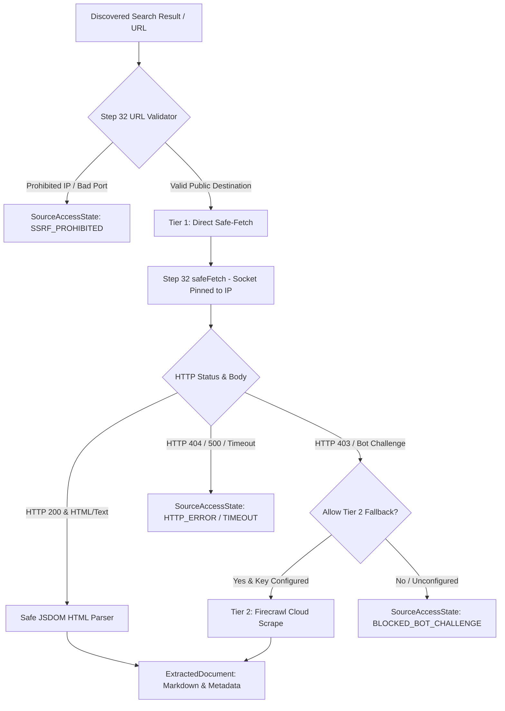

# VerityScout AI — Source Extraction Architecture Specification

**Document Identifier:** VS-EXTRACT-ARCH-v1.0  
**Status:** APPROVED ARCHITECTURAL SPECIFICATION  
**Phase:** Phase 7 (Step 34 of 60)  
**Author:** Senior Web Extraction Architect, Application Security Lead  
**Classification:** Server-Side Web Extraction Infrastructure  
**Traceability:** Mapped to [ADR-005](file:///e:/Projects/All%20working%20projects/Website%20Working%20Projects/VerityScout%20AI%20WEB%20(working)/docs/architecture/adr/ADR-005-search-and-extraction-provider-abstraction.md), [DEC-006](file:///e:/Projects/All%20working%20projects/Website%20Working%20Projects/VerityScout%20AI%20WEB%20(working)/docs/requirements/DECISION_REGISTER.md#2-confirmed-technical-decisions-dec), [PROVIDER_EVALUATION.md](file:///e:/Projects/All%20working%20projects/Website%20Working%20Projects/VerityScout%20AI%20WEB%20(working)/docs/research/PROVIDER_EVALUATION.md), and [IMPLEMENTATION_TRACEABILITY.md](file:///e:/Projects/All%20working%20projects/Website%20Working%20Projects/VerityScout%20AI%20WEB%20(working)/docs/architecture/IMPLEMENTATION_TRACEABILITY.md) (`UR-006`, `AC-006`).

---

## 1. Executive Summary & Purpose

VerityScout AI retrieves web documents discovered during search operations (Step 33) to extract candidate product specifications, retailer prices, and benchmark evidence.

This specification defines the server-side extraction architecture implemented in Step 34 (`src/server/extraction/`). In strict compliance with `ADR-005` and `DEC-006`, the application implements a **Two-Tier Web Extraction Strategy**:
1. **Tier 1 (Direct Safe-Fetch):** In-house, zero-cost static document retrieval via Step 32 `safeFetch` and local, script-inert JSDOM parsing.
2. **Tier 2 (Managed Cloud Extraction):** Fallback extraction adapter (Firecrawl) for dynamic client-rendered SPAs or domains requiring smart proxy handling.
3. **Mock Extraction Adapter (`mock_extract`):** High-fidelity, deterministic test double for CI and local unit tests with zero external network access.

---

## 2. Architecture & Two-Tier Strategy

### 2.1 Tier 1: Direct Safe-Fetch (Default & Zero-Cost)
- **Transport:** Dispatched via Step 32 `safeFetch` using `PUBLIC_RESEARCH_SOURCE_POLICY`.
- **SSRF Immunity:** Sockets are pinned directly to validated public IPs, immune to DNS rebinding. Private subnets (RFC 1918), loopback (`127.0.0.1`), and cloud metadata (`169.254.169.254`) are rejected before connection.
- **Parsing:** In-memory JSDOM DOM parser with `runScripts: undefined` and default resource loading (inert).
- **Cost:** $0.00 external API fees; negligible CPU and RAM consumption.

### 2.2 Tier 2: Managed Cloud Extraction (Firecrawl Fallback)
- **Official API Documentation:** [https://docs.firecrawl.dev/](https://docs.firecrawl.dev/)
- **Endpoint:** `POST https://api.firecrawl.dev/v1/scrape`
- **Authentication:** `Authorization: Bearer <apiKey>`
- **Transport:** Mediated via `safeFetch` with `TRUSTED_PROVIDER_POLICY` targeting `api.firecrawl.dev`.
- **Trigger Conditions:** Invoked only if Tier 1 encounters `BLOCKED_BOT_CHALLENGE` or `EMPTY_BODY`, AND the caller explicitly passes `allowTier2Fallback: true`, AND a valid Firecrawl credential exists in the AES-256-GCM vault.
- **Cost:** 1 credit per scraped page.

---

## 3. Safe HTML Parsing & Content Normalization

Untrusted HTML downloaded from the web is parsed in `src/server/extraction/html-parser.ts` under strict security invariants:

### 3.1 Inert DOM & Script Prohibition
- **Zero Script Execution:** Scripts (`<script>`), inline handlers (`onload`, `onerror`), and `javascript:` URIs are never executed.
- **Zero Subresource Loading:** External stylesheets, remote images, frames (`<iframe>`), fonts, and media are strictly blocked.
- **Element Budget:** Maximum 10,000 DOM elements per document to prevent memory exhaustion and ReDoS attacks.

### 3.2 Boilerplate Stripping
The parser removes non-substantive page chrome prior to content normalization:
- Navigation bars (`<nav>`, `[role="navigation"]`)
- Header and footer blocks (`<header>`, `<footer>`, `[role="contentinfo"]`)
- Sidebars and auxiliary containers (`<aside>`)
- Cookie consent overlays (`.cookie-banner`, `#cookie-consent`)
- Advertisements and sponsored modules (`.ad`, `.advertisement`)
- Social sharing widgets and user comment sections

### 3.3 Main Content Identification & Markdown Conversion
- **Container Discovery:** Targets `<main>`, `<article>`, or `[role="main"]`. If absent, defaults to cleaned `<body>`.
- **Markdown Normalization:**
  - Headings (`h1`–`h6`) $\to$ `# `, `## `, `### `
  - Paragraphs (`p`) $\to$ Text followed by line breaks
  - Lists (`ul`, `ol`) $\to$ `- Item` or `1. Item`
  - Blockquotes (`blockquote`) $\to$ `> Quoted text`
  - Tables (`table`) $\to$ Clean Markdown tables with header separators (`| Col1 | Col2 |`)
  - Code blocks (`pre`, `code`) $\to$ Fenced code blocks
- **Tag Stripping:** All remaining raw HTML tags are stripped. Raw HTML is **never** emitted to downstream consumers.

---

## 4. Metadata Extraction & Truthful Representation

Metadata is extracted strictly from official HTML meta tags and document attributes without fabrication:
- **Title:** Evaluated in order: `<meta property="og:title">` $\to$ `<meta name="twitter:title">` $\to$ `<title>` $\to$ `<h1>`.
- **Author:** Evaluated from `<meta name="author">`, `<meta property="article:author">`, or `[rel="author"]`.
- **Publisher:** Evaluated from `<meta property="og:site_name">` or `<meta name="publisher">`.
- **Publication Date:** Sourced from `<meta property="article:published_time">`, `<time datetime="...">`, `<meta name="pubdate">`, or `<meta name="date">`. Validated against ISO 8601.
- **Language:** Sourced from `<html lang="...">` or `<meta http-equiv="content-language">`.
- **Null Invariant:** If metadata is absent on the source page, values remain strictly `null`. Current timestamps are **never** substituted for missing publication dates.

---

## 5. Resource Limits & Bounded Execution

All operations are governed by hard server-side limits enforced in `SourceExtractionService`:

| Resource Parameter | Default Value | Hard Architectural Cap | Governing Constraint |
|---|---|---|---|
| **Max URLs per Batch** | `10` URLs | **`10` URLs** | `SEC-035`, `ADR-005` |
| **Max Payload Size** | `5,242,880` bytes (5 MB) | **`5,242,880` bytes** | Streaming socket termination (`SEC-014`) |
| **Response Timeout** | `15,000` ms (15s) | **`15,000` ms** | Socket read timeout (`SEC-014`) |
| **Extraction Concurrency** | `2` parallel workers | **`3` parallel workers** | Socket and CPU bounding |
| **Max Markdown Output** | `512,000` bytes (500 KB) | **`512,000` bytes** | Memory safety |
| **Max Excerpt Length** | `800` characters | **`1,000` characters** | UI preview bounding |

