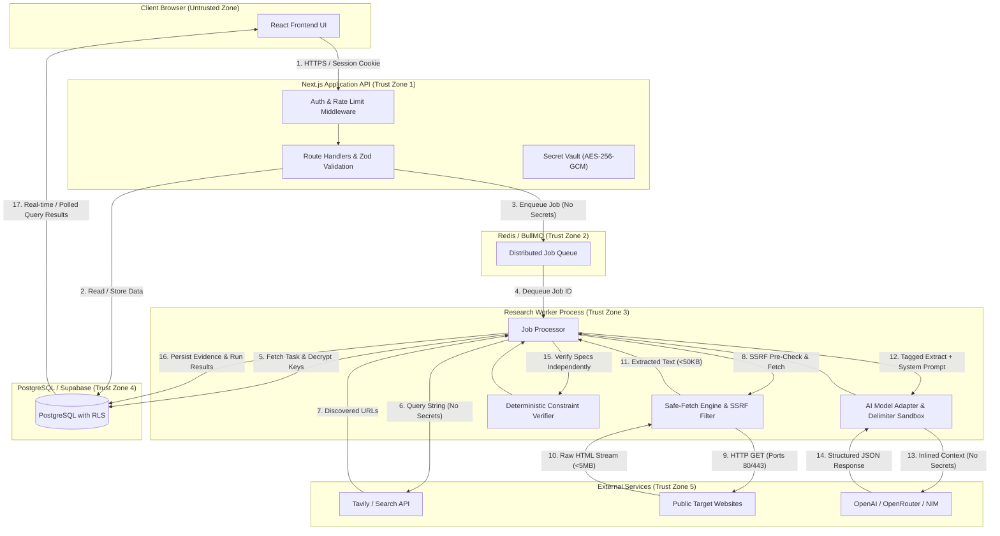

# VerityScout AI - Privacy Engineering and Data-Flow Specification

**Document Identifier:** VS-PRIV-SPEC-v1.0  
**Status:** DRAFT / APPROVED BASELINE FOR IMPLEMENTATION  
**Phase:** Phase 1 (Step 4 of 60)  
**Author:** Principal Application Security Architect & Privacy Engineer  
**Traceability:** Mapped to [THREAT_MODEL.md](file:///e:/Projects/All%20working%20projects/Website%20Working%20Projects/VerityScout%20AI%20WEB%20(working)/docs/security/THREAT_MODEL.md), [SECURITY_REQUIREMENTS.md](file:///e:/Projects/All%20working%20projects/Website%20Working%20Projects/VerityScout%20AI%20WEB%20(working)/docs/security/SECURITY_REQUIREMENTS.md), and [MVP_REQUIREMENTS.md](file:///e:/Projects/All%20working%20projects/Website%20Working%20Projects/VerityScout%20AI%20WEB%20(working)/docs/requirements/MVP_REQUIREMENTS.md).

---

## 1. Executive Summary & Privacy Principles

VerityScout AI is designed from inception with strict **Privacy by Design** principles. Unlike generic search scrapers that hoard raw internet telemetry or mirror arbitrary third-party web content, VerityScout AI enforces data minimization, tenant boundary isolation, cryptographic credential separation, and explicit transparency regarding third-party external data sharing.

### Core Privacy Tenets:
1. **Zero Client-Side Secret Leakage:** Provider API keys, credentials, and infrastructure tokens are strictly isolated to server-side encrypted memory; no secrets are ever broadcast to client runtimes or external search query payloads.
2. **Data Minimization:** Raw HTML web pages, analytics tracking scripts, and multi-megabyte DOMs are discarded immediately upon extraction; only concise textual excerpts and verified structured claims (<= 50 KB per record) are persisted.
3. **Explicit External Disclosure:** Users are explicitly informed prior to query execution regarding which third-party search and AI providers will receive their query strings.
4. **Tenant Isolation & Right to Erasure:** All research tasks, evidence records, and execution logs are strictly bound to authenticated user identities. Deleting a research task initiates an atomic, cascading purge across persistence stores and distributed queues.

---

## 2. Data Classification Matrix

VerityScout AI handles five distinct tiers of information assets:

| Tier | Category | Examples | Sensitivity | Confidentiality Requirement | Retention Policy |
|---|---|---|---|---|---|
| **Tier 1** | **Authentication & Infrastructure Secrets** | Session tokens, database passwords, encryption keys (`VAULT_MASTER_KEY`), Redis URLs | **Critical** | Zero persistence in client; encrypted at rest; strict logging redaction | Active session duration / immediate invalidation on rotation |
| **Tier 2** | **Third-Party Provider API Keys** | OpenAI, OpenRouter, NVIDIA NIM, Tavily, Firecrawl keys | **Critical / High** | AES-256-GCM encrypted in database; decrypted only in-memory during active HTTP call | Persisted until deleted by user in Settings UI |
| **Tier 3** | **User Research Data & Queries** | Natural language queries, product constraints, research reports, verified evidence records | **Confidential** | Owner-scoped via PostgreSQL RLS; no cross-tenant sharing | Persisted until explicitly deleted by user |
| **Tier 4** | **Extracted Web Extracts** | Webpage titles, extracted snippet markdown, product spec tables | **Public / Untrusted** | Sanitized via DOMPurify; isolated from prompt instructions | Bound to research run; deleted upon task cascade deletion |
| **Tier 5** | **Operational Telemetry & Logs** | Run duration, token consumption counts, HTTP status codes, error traces | **Internal** | Scrubbed of secrets and user queries; restricted to admins | 30-day rolling log retention |

> [!IMPORTANT]
> **Research Queries as Proprietary Data:** User research queries often represent proprietary commercial intent, private market research, or personal purchasing dilemmas. Even though they may not contain traditional PII (names, Social Security numbers), they are classified as **Tier 3 (Confidential)** and must never be leaked across user boundaries or logged in unredacted telemetry.

---

## 3. End-to-End System Data Flow Diagram

---

## 4. Detailed Data-Flow Specifications Across Core Operations

### Operation 1: User Signs In
- **Origin:** Browser Client (`POST /api/auth/signin`).
- **Destination:** Next.js Auth Handler -> PostgreSQL `auth.users` / Supabase Auth.
- **Data Types Involved:** User email, hashed password / session credentials.
- **Sensitivity:** Tier 1 (Critical).
- **Trust Boundary Crossed:** TB-1 (Browser to Server).
- **Providers Receiving Data:** Internal database only.
- **Authorization:** Public endpoint with strict rate limiting (SEC-009).
- **Storage Location:** PostgreSQL `auth.users` (hashed via Argon2/bcrypt).
- **Retention & Deletion:** Session cookie valid for max 7 days; immediate invalidation on sign-out (SEC-010).
- **Security Controls:** TLS 1.3, `HttpOnly` `Secure` `SameSite=Lax` cookies, rate limiting (5 attempts/min).

### Operation 2: User Submits a Research Query
- **Origin:** Browser Client (`POST /api/tasks`).
- **Destination:** Application API (`/api/tasks`).
- **Data Types Involved:** Query string (e.g., "Find RTX 4070 GPU under $550"), constraint parameters (price, length, stock), preferred provider settings.
- **Sensitivity:** Tier 3 (Confidential).
- **Trust Boundary Crossed:** TB-1 (Browser to Server).
- **Providers Receiving Data:** None at this stage.
- **Authorization:** Authenticated user session required.
- **Storage Location:** PostgreSQL `tasks` table with `user_id = auth.uid()`.
- **Retention & Deletion:** Retained until user deletes task.
- **Security Controls:** Zod input validation (max 500 chars), parameterization (SEC-023, SEC-024).

### Operation 3: Query Constraints Are Parsed and Structured
- **Origin:** Application API / Worker.
- **Destination:** In-memory execution context.
- **Data Types Involved:** Parsed constraint rules (`budgetMax: 550`, `currency: USD`, `lengthMaxMm: 320`).
- **Sensitivity:** Tier 3 (Confidential).
- **Trust Boundary Crossed:** Internal server memory.
- **Providers Receiving Data:** None.
- **Authorization:** Inherited from authenticated task creation.
- **Storage Location:** PostgreSQL `tasks.constraints` (JSONB).
- **Retention & Deletion:** Persisted with task record.
- **Security Controls:** Strict typing, numeric range bounds.

### Operation 4: Research Job Is Enqueued
- **Origin:** Application API (`POST /api/tasks/:id/run`).
- **Destination:** Redis Job Queue (BullMQ `research-jobs`).
- **Data Types Involved:** Job metadata: `{ taskId: UUID, runId: UUID, userId: UUID, action: "EXECUTE_RESEARCH" }`.
- **Sensitivity:** Internal Job Reference.
- **Trust Boundary Crossed:** TB-2 (API to Redis Queue).
- **Providers Receiving Data:** Redis infrastructure only.
- **Authorization:** Owner verification on task prior to enqueue (SEC-007).
- **Storage Location:** In-memory Redis store with append-only file (AOF) persistence.
- **Retention & Deletion:** Auto-removed from Redis upon successful completion or DLQ routing (SEC-028).
- **Security Controls:** **Strict prohibition of plaintext API keys or raw user data in Redis payloads (SEC-005).**

### Operation 5: Search Provider Receives Approved Query
- **Origin:** Research Worker Process.
- **Destination:** Approved Search Service (Tavily / Search API).
- **Data Types Involved:** Search query string (e.g. "RTX 4070 GPU site:retailer.com"), search filters, decrypted provider API key in `Authorization` header.
- **Sensitivity:** Tier 2 (Key) & Tier 3 (Query).
- **Trust Boundary Crossed:** TB-4 (Worker to Third-Party Search Provider).
- **Providers Receiving Data:** External search provider (Tavily).
- **Authorization:** Encrypted key loaded from DB, decrypted just-in-time, transmitted via HTTPS.
- **Storage Location:** External provider logging policies apply; zero query caching in unencrypted transit.
- **Retention & Deletion:** External provider retention governed by their privacy policy; VerityScout AI retains returned search URLs.
- **Security Controls:** HTTPS TLS 1.3, provider key kept in server memory, circuit breaker protection (SEC-038).
- **User Disclosure:** UI prominently indicates that query strings are transmitted to Tavily (SEC-034).

### Operation 6: Remote Page Extraction Occurs
- **Origin:** Research Worker / Safe-Fetch Client.
- **Destination:** Public Target Websites (Retailers, forums, news).
- **Data Types Involved:** HTTP GET request with standard User-Agent; incoming raw HTML content.
- **Sensitivity:** Tier 4 (Public Untrusted Web Content).
- **Trust Boundary Crossed:** TB-3 (Worker to Arbitrary Public Internet).
- **Providers Receiving Data:** Target web servers receive client IP and requested URL.
- **Authorization:** Public internet retrieval.
- **Storage Location:** Raw stream buffered in worker memory; discarded after parsing.
- **Retention & Deletion:** Raw HTML is never saved to the database (SEC-032).
- **Security Controls:** Pre-fetch DNS resolution against private IP blocklist (SEC-012), redirect verification (SEC-013), 5 MB max response limit (SEC-014), port restrictions 80/443 (SEC-015).

### Operation 7: Evidence Is Stored
- **Origin:** Research Worker Extractor.
- **Destination:** PostgreSQL `evidence_records` table.
- **Data Types Involved:** Canonical URL, page title, extracted text snippet (max 50 KB), timestamp, hash of content, extracted price/spec tokens.
- **Sensitivity:** Tier 4 (Untrusted / Sanitized).
- **Trust Boundary Crossed:** TB-5 (Worker to Database).
- **Providers Receiving Data:** Internal database.
- **Authorization:** Worker authenticated via internal service role; records bound to `user_id` and `task_id`.
- **Storage Location:** PostgreSQL `evidence_records` table.
- **Retention & Deletion:** Bound to parent task; cascading deletion on task purge (SEC-033).
- **Security Controls:** HTML sanitization via DOMPurify prior to display (SEC-021), normalized text chunking (SEC-032).

### Operation 8: Extracted Content Is Sent to an Approved LLM
- **Origin:** Research Worker Prompt Builder.
- **Destination:** Approved AI Provider (OpenAI / OpenRouter / NVIDIA NIM).
- **Data Types Involved:** System prompt, user research objective, and extracted webpage text framed inside `<untrusted_web_source>` delimiter tags.
- **Sensitivity:** Tier 3 (Query) & Tier 4 (Untrusted Web Extracts).
- **Trust Boundary Crossed:** TB-4 (Worker to External AI Provider).
- **Providers Receiving Data:** Selected LLM provider.
- **Authorization:** Provider selected via user whitelist; API key transmitted in HTTPS header.
- **Storage Location:** External provider inference server; VerityScout AI persists model response.
- **Retention & Deletion:** Governed by provider API data terms (OpenAI zero-retention on API tier).
- **Security Controls:** **Zero secrets in prompts (SEC-020)**, structured XML delimiters (SEC-016), privacy-enforced whitelist routing (SEC-031).
- **User Disclosure:** User selects LLM provider; notified of external dispatch (SEC-034).

### Operation 9: Result and Sources Are Persisted
- **Origin:** Research Worker.
- **Destination:** PostgreSQL `research_runs` and `reports` tables.
- **Data Types Involved:** Synthesized summary markdown, constraint evaluation statuses (`VERIFIED`, `REFUTED`), structured findings, token counts, cost estimate.
- **Sensitivity:** Tier 3 (Confidential).
- **Trust Boundary Crossed:** TB-5 (Worker to Database).
- **Providers Receiving Data:** Internal database.
- **Authorization:** Worker persistence transaction; verified against `run_id`.
- **Storage Location:** PostgreSQL `research_runs` table.
- **Retention & Deletion:** Cascade deleted when task is removed.
- **Security Controls:** Parameterized inserts (SEC-023), deterministic constraint overrides applied before write (SEC-017).

### Operation 10: Scheduled Task Runs Again
- **Origin:** BullMQ Repeatable Job Scheduler.
- **Destination:** Worker Process -> Database -> External Providers.
- **Data Types Involved:** Idempotency key `SHA256(taskId + slotTimestamp)`, task ID.
- **Sensitivity:** Internal Schedule Reference.
- **Trust Boundary Crossed:** TB-2 and TB-5.
- **Providers Receiving Data:** Providers re-invoked only if validation succeeds.
- **Authorization:** **Mandatory atomic pre-check: Worker queries task status; if paused, deleted, or budget depleted, job terminates immediately with zero external calls (SEC-026).**
- **Storage Location:** PostgreSQL `schedules` and `research_runs`.
- **Retention & Deletion:** Scheduled jobs cancelled upon task deletion.
- **Security Controls:** Deterministic idempotency key deduplication (SEC-027), minimum 6-hour interval enforcement (SEC-036).

### Operation 11: Change Event Is Recorded
- **Origin:** Research Worker Comparator Engine.
- **Destination:** PostgreSQL `change_events` table.
- **Data Types Involved:** Field name (e.g. `price`), previous value (`$549.99`), new value (`$499.00`), diff magnitude (`-9.1%`), timestamp.
- **Sensitivity:** Tier 3 (Confidential).
- **Trust Boundary Crossed:** TB-5 (Worker to Database).
- **Providers Receiving Data:** Internal database.
- **Authorization:** Worker internal transaction bound to `task_id`.
- **Storage Location:** PostgreSQL `change_events` table.
- **Retention & Deletion:** Purged when task is deleted.
- **Security Controls:** Deterministic comparator logic, duplicate event suppression (SEC-027).

### Operation 12: Approved Notification Is Dispatched
- **Origin:** Notification Service.
- **Destination:** In-App Notification Center / User Interface.
- **Data Types Involved:** Notification title, change summary, deep link to research run.
- **Sensitivity:** Tier 3 (Confidential).
- **Trust Boundary Crossed:** TB-1 (Server to Client UI).
- **Providers Receiving Data:** In-app only for MVP baseline.
- **Authorization:** User-scoped notification query (`WHERE user_id = auth.uid()`).
- **Storage Location:** PostgreSQL `notifications` table.
- **Retention & Deletion:** Retained until dismissed or purged after 30 days.
- **Security Controls:** DOMPurify sanitization of notification payload, zero secret inclusion.

### Operation 13: User Exports or Deletes Research Records
- **Origin:** Browser Client (`GET /api/tasks/:id/export` or `DELETE /api/tasks/:id`).
- **Destination:** Export Stream to Client / Database Cascade Purge.
- **Data Types Involved:** JSON/CSV report payload or deletion confirmation.
- **Sensitivity:** Tier 3 (Confidential).
- **Trust Boundary Crossed:** TB-1 (API to Client) and TB-5 (API to Database).
- **Providers Receiving Data:** None.
- **Authorization:** Strict owner validation `WHERE id = :id AND user_id = :authUserId` (SEC-007).
- **Storage Location:** Transitory HTTP response for exports; permanent deletion in DB/Redis.
- **Retention & Deletion:** Immediate purge of all related runs, evidence, and queued jobs (SEC-033).
- **Security Controls:** CSV formula injection neutralization (`'`), filename regex sanitization (`^[a-zA-Z0-9_-]+$`) (SEC-025), zero credentials in exported files.

---

## 5. Unresolved Jurisdictional and Regulatory Considerations

> [!WARNING]
> **Pre-Launch Regulatory Review Required:**
> VerityScout AI's primary target deployment region, hosting jurisdiction, and commercial launch markets have not been formally designated by project stakeholders.
> 
> Prior to opening public user registration or accepting commercial payments, the following legal reviews must be executed:
> 1. **GDPR / UK GDPR Compliance:** If European Union or UK residents are permitted to register, formal Data Processing Addenda (DPAs) must be reviewed for candidate cloud providers (Supabase, OpenAI, Tavily), and a designated Data Protection Officer (DPO) / representative must be evaluated.
> 2. **CCPA / CPRA Compliance:** California consumer privacy disclosure requirements regarding commercial web scraping data provenance and third-party data transmission.
> 3. **Copyright & Web Scraping Terms of Service:** Web extraction must respect standard `robots.txt` directives where legally required and maintain bounded request rates to avoid violating computer crime statutes (e.g. CFAA).

---

## 6. Privacy Verification and Audit Guidelines

Future development steps must verify privacy guarantees through automated tests:
- **Test PRIV-01:** Exported JSON and CSV files must be parsed to confirm that no provider API keys, session tokens, or other users' data are present.
- **Test PRIV-02:** When an automated run executes, verify via HTTP interceptors that external provider payloads contain only approved query strings and delimiter-wrapped extracts; verify zero telemetry beacons to unapproved domains.
- **Test PRIV-03:** After deleting a task via `DELETE /api/tasks/:id`, verify that subsequent direct database queries for that `task_id` in `tasks`, `research_runs`, `evidence_records`, and `change_events` return exactly zero records.
